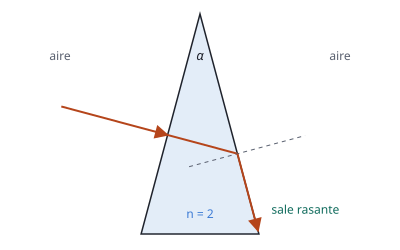

## Enunciado

Un material transparente de índice de refracción $n = 2$ se encuentra situado en el aire y limitado por dos superficies planas no paralelas que forman un ángulo $\alpha$. Sabiendo que el rayo de luz monocromática que incide perpendicularmente sobre la primera superficie emerge por la segunda con un ángulo de 90° con respecto a la normal, como se muestra en la figura, determine:

1. El valor del ángulo límite para la incidencia material-aire y el valor del ángulo $\alpha$.
2. El ángulo de incidencia de un rayo en la primera superficie para que el ángulo de emergencia por la segunda sea igual que él.

**Dato:** Índice de refracción del aire, $n_\text{aire} = 1$.

## Datos

- $n = 2$
- Incidencia normal en la primera cara; salida rasante (90°) por la segunda

## Planteamiento

Con incidencia normal el rayo entra sin desviarse. Llega a la segunda cara con un ángulo igual al del prisma, $\alpha$ (los lados del ángulo son perpendiculares a las caras). Si sale a 90°, ese ángulo es el límite.

En general, dentro del prisma $r + r' = \alpha$. Si la incidencia y la emergencia son iguales, el camino es simétrico: $r = r' = \alpha/2$.

## Resolución

### a) Ángulo límite y ángulo del prisma

$$\operatorname{sen}L = \frac{1}{2}
\quad\Longrightarrow\quad
L = 30°$$

Como el rayo llega a la segunda cara con el ángulo límite y ese ángulo es igual al del prisma:

$$\alpha = L = 30°$$

### b) Incidencia con salida simétrica

$$r = r' = \frac{\alpha}{2} = 15°$$

$$\operatorname{sen}i = 2\operatorname{sen}15° = 0{,}518
\quad\Longrightarrow\quad
i = 31{,}2°$$

Y por simetría el rayo sale también con 31,2°. Es la situación de desviación mínima.

## Errores típicos

- Pensar que con incidencia normal el rayo llega también normal a la segunda cara.
- Calcular el ángulo límite con $\operatorname{sen}L = 2$.
