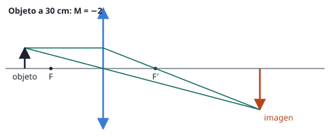
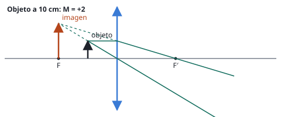

## Enunciado

Una lente convergente forma de un objeto real una imagen real aumentada dos veces. Al desplazar el objeto 20 cm hacia la lente, la imagen que se obtiene es virtual y con el mismo aumento en valor absoluto.

1. Determine la potencia y la distancia focal de la lente.
2. Realice el diagrama de rayos correspondiente.

## Datos

- Primera posición: imagen real, por tanto invertida: $M_1 = -2$
- Segunda posición, 20 cm más cerca: imagen virtual, por tanto derecha: $M_2 = +2$
- $s_2 = s_1 + 20\ \mathrm{cm}$

## Planteamiento

Con $s' = M s$, la ecuación de las lentes da la posición del objeto en función de la focal y el aumento:

$$\frac{1}{M s} - \frac{1}{s} = \frac{1}{f'}
\quad\Longrightarrow\quad
s = f'\left(\frac{1}{M} - 1\right)$$

Las dos posiciones difieren en 20 cm: eso da una ecuación para $f'$.

## Resolución

### a) Focal y potencia

$$s_1 = f'\left(-\frac12 - 1\right) = -\frac32 f'
\qquad\qquad
s_2 = f'\left(\frac12 - 1\right) = -\frac12 f'$$

$$s_2 - s_1 = -\frac12 f' + \frac32 f' = f' = 20\ \mathrm{cm}$$

$$P = \frac{1}{f'} = \frac{1}{0{,}20} = 5\ \mathrm{D}$$

Las posiciones son $s_1 = -30\ \mathrm{cm}$ (imagen en $s_1' = 60\ \mathrm{cm}$) y $s_2 = -10\ \mathrm{cm}$ (imagen en $s_2' = -20\ \mathrm{cm}$).

### b) Diagramas de rayos

Con el objeto a 30 cm, entre $2f$ y $f$, el rayo paralelo sale por $F'$ y el central no se desvía; se cortan a 60 cm detrás de la lente:

Con el objeto a 10 cm, entre el foco y la lente, los rayos salen divergentes; sus prolongaciones se cortan a 20 cm, del mismo lado que el objeto:

## Errores típicos

- Tomar el mismo signo para los dos aumentos: la imagen real está invertida y la virtual, derecha.
- Plantear $s_2 = s_1 - 20$: acercarse a la lente hace $s$ menos negativo.
