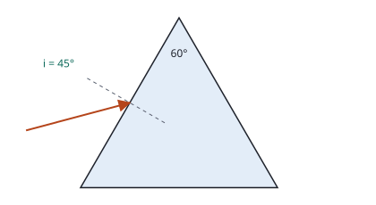
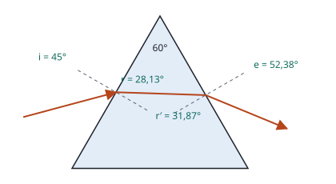
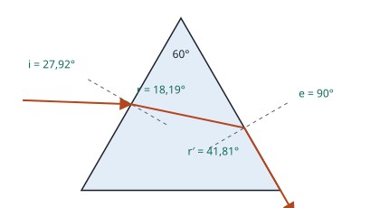

## Enunciado

Sobre un material transparente limitado por dos superficies planas que forman un ángulo de 60° incide, desde el aire, un rayo de luz monocromática con un ángulo $i = 45°$, tal y como se muestra en la figura. Si el índice de refracción del material para esa radiación monocromática es 1,5, determine:

1. Los ángulos de refracción en cada una de las superficies.
2. El menor valor del ángulo de incidencia en la primera superficie para que el rayo pueda emerger a través de la segunda superficie.

**Dato:** Índice de refracción del aire, $n_\text{aire} = 1$.

## Datos

- Ángulo del prisma: $A = 60°$; $n = 1{,}5$
- Incidencia en la primera cara: $i = 45°$

## Planteamiento

Ley de Snell en cada cara. Dentro del prisma, el ángulo de refracción en la primera cara, $r$, y el de incidencia en la segunda, $r'$, suman el ángulo del prisma: $r + r' = A$ (sale del triángulo que forman las dos normales con el vértice).

Para que el rayo salga, $r'$ no puede superar el ángulo límite del vidrio.

## Resolución

### a) Ángulos con i = 45°

Primera cara:

$$\operatorname{sen}45° = 1{,}5\operatorname{sen}r
\quad\Longrightarrow\quad
r = 28{,}1°$$

Incidencia en la segunda cara:

$$r' = A - r = 60° - 28{,}1° = 31{,}9°$$

Salida al aire:

$$1{,}5\operatorname{sen}31{,}9° = \operatorname{sen}e
\quad\Longrightarrow\quad
e = 52{,}4°$$

### b) Incidencia mínima para que salga

Ángulo límite del vidrio con el aire:

$$\operatorname{sen}L = \frac{1}{1{,}5}
\quad\Longrightarrow\quad
L = 41{,}8°$$

El rayo sale si $r' \le L$, es decir, si $r \ge 60° - 41{,}8° = 18{,}2°$:

$$\operatorname{sen}i_\text{mín} = 1{,}5\operatorname{sen}18{,}2°
\quad\Longrightarrow\quad
i_\text{mín} = 27{,}9°$$

Con menos incidencia, el rayo llega a la segunda cara con más del ángulo límite y se refleja por completo.

## Errores típicos

- Tomar $r' = r$, como si las caras fueran paralelas.
- Pensar que el rayo deja de salir al aumentar la incidencia: es al revés, deja de salir al disminuirla.
