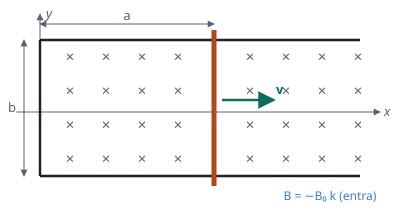

## Enunciado

Sea un campo magnético uniforme $\vec B = -B_0\,\vec k$, con $B_0 = 0{,}3\ \mathrm{T}$. En el plano $xy$ hay una espira rectangular cuyos lados miden, inicialmente, $a = 1\ \mathrm{m}$ y $b = 0{,}5\ \mathrm{m}$. La varilla de longitud $b$ se puede desplazar en la dirección del eje $x$, tal y como se ilustra en la figura. Determine, para $t = 2\ \mathrm{s}$, el flujo a través de la espira y la fuerza electromotriz inducida en la misma si:

1. La varilla se desplaza con velocidad constante de $3\ \mathrm{m\,s^{-1}}$.
2. Partiendo del reposo, la varilla se desplaza con aceleración constante de $2\ \mathrm{m\,s^{-2}}$.

## Datos

- $B_0 = 0{,}3\ \mathrm{T}$, perpendicular a la espira (entra en el papel)
- Lado fijo $b = 0{,}5\ \mathrm{m}$; posición inicial de la varilla, $a = 1\ \mathrm{m}$

## Planteamiento

El área de la espira es $b\cdot x(t)$, donde $x(t)$ es la posición de la varilla. El flujo vale $\Phi = B_0\,b\,x(t)$ en módulo, y la fem, $|\varepsilon| = B_0\,b\,v(t)$.

## Resolución

### a) Velocidad constante

$$x(2) = 1 + 3\cdot 2 = 7\ \mathrm{m}
\qquad\qquad
|\Phi| = B_0\,b\,x = 0{,}3\cdot 0{,}5\cdot 7 = 1{,}05\ \mathrm{Wb}$$

$$|\varepsilon| = B_0\,b\,v = 0{,}3\cdot 0{,}5\cdot 3 = 0{,}45\ \mathrm{V}$$

Es constante: el área crece al mismo ritmo todo el tiempo.

### b) Aceleración constante desde el reposo

$$x(2) = 1 + \tfrac12\cdot 2\cdot 2^2 = 5\ \mathrm{m}
\qquad\qquad
|\Phi| = 0{,}3\cdot 0{,}5\cdot 5 = 0{,}75\ \mathrm{Wb}$$

$$v(2) = 2\cdot 2 = 4\ \mathrm{m\,s^{-1}}
\qquad\qquad
|\varepsilon| = 0{,}3\cdot 0{,}5\cdot 4 = 0{,}60\ \mathrm{V}$$

Ahora la fem crece con el tiempo, porque la varilla va cada vez más deprisa.

En los dos casos el flujo entrante aumenta, así que la corriente inducida circula en sentido antihorario, para crear un campo saliente que se oponga al aumento.

## Errores típicos

- Usar solo el desplazamiento ($vt$) y olvidar el área inicial ($a = 1\ \mathrm{m}$) en el flujo.
- Usar la velocidad media en lugar de la instantánea en el caso b.
