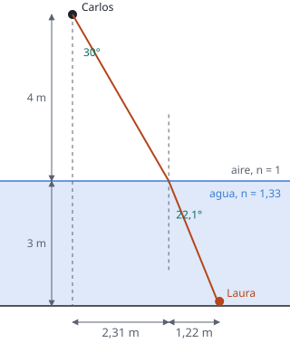

## Enunciado

Desde lo alto de un trampolín, Carlos es capaz de ver a Laura, que está buceando en el fondo de la piscina. Para ello tiene que mirar con un ángulo de 30° con respecto a la vertical. La altura de observación es de 4 m y la piscina tiene una profundidad de 3 m. Si el índice de refracción del agua es $n_\text{agua} = 1{,}33$, determine:

1. La distancia respecto a la vertical del trampolín a la que se encuentra Laura.
2. El ángulo límite entre ambos medios y realice un esquema indicando la marcha del rayo.

**Dato:** Índice de refracción del aire, $n_0 = 1$.

## Datos

- Altura de los ojos de Carlos sobre el agua: 4 m
- Profundidad: 3 m
- Ángulo con la vertical en el aire: 30°

## Planteamiento

La luz va de Laura a Carlos, pero el camino es el mismo en los dos sentidos. En el aire el rayo forma 30° con la vertical; al entrar en el agua se acerca a la normal según la ley de Snell. La distancia horizontal total es la suma de los dos tramos.

## Resolución

### a) Distancia de Laura a la vertical del trampolín

Tramo en el aire:

$$d_1 = 4\tan 30° = 2{,}31\ \mathrm{m}$$

Ángulo en el agua:

$$1\cdot\operatorname{sen}30° = 1{,}33\operatorname{sen}r
\quad\Longrightarrow\quad
r = \arcsen\frac{0{,}5}{1{,}33} = 22{,}1°$$

Tramo en el agua:

$$d_2 = 3\tan 22{,}1° = 1{,}22\ \mathrm{m}$$

$$d = d_1 + d_2 = 2{,}31 + 1{,}22 = 3{,}53\ \mathrm{m}$$

### b) Ángulo límite y marcha del rayo

$$\theta_L = \arcsen\frac{n_0}{n_\text{agua}} = \arcsen\frac{1}{1{,}33} = 48{,}8°$$

Es el ángulo, medido dentro del agua, a partir del cual la luz que va del agua al aire ya no sale y se refleja por completo. El rayo de Laura llega a la superficie con 22,1°, menos que el ángulo límite, así que sale al aire y Carlos la ve.

## Errores típicos

- Prolongar el rayo en línea recta dentro del agua (saldría $7\tan 30° = 4{,}04\ \mathrm{m}$).
- Aplicar Snell con los índices cambiados: en el agua el rayo se acerca a la normal.
