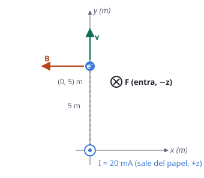

## Enunciado

1. Enuncie el teorema de Ampère.
2. Un hilo conductor indefinido situado a lo largo del eje $z$ transporta una corriente de 20 mA en sentido positivo del eje. Calcule la fuerza magnética experimentada por un electrón que lleva una velocidad de $10^{5}\ \mathrm{m\,s^{-1}}$ en la dirección positiva del eje $y$ cuando se encuentra en la posición $(0, 5, 0)$ m.

**Datos:** Valor absoluto de la carga del electrón, $e = 1{,}6\cdot 10^{-19}\ \mathrm{C}$; Permeabilidad magnética del vacío, $\mu_0 = 4\pi\cdot 10^{-7}\ \mathrm{N\,A^{-2}}$.

## Datos

- $I = 0{,}020\ \mathrm{A}$ hacia $+z$
- Electrón en $(0, 5, 0)$ m, a $d = 5\ \mathrm{m}$ del hilo, con $\vec v = 10^{5}\,\vec j\ \mathrm{m\,s^{-1}}$

## Planteamiento

El campo de un hilo indefinido sale del teorema de Ampère: sus líneas son circunferencias alrededor del hilo, con el sentido que da la regla de la mano derecha. La fuerza sobre el electrón es $\vec F = q\,\vec v\times\vec B$ con $q = -e$.

## Resolución

### a) Teorema de Ampère

La circulación del campo magnético a lo largo de cualquier línea cerrada es igual a $\mu_0$ por la intensidad neta que atraviesa la superficie limitada por esa línea:

$$\oint \vec B\cdot\mathrm{d}\vec l = \mu_0\,\sum I$$

Las corrientes cuentan con signo, según su sentido respecto al de recorrido de la línea (regla de la mano derecha).

### b) Fuerza sobre el electrón

Para un hilo indefinido, tomando una circunferencia de radio $d$ centrada en el hilo, $B\cdot 2\pi d = \mu_0 I$:

$$B = \frac{\mu_0\,I}{2\pi d} = \frac{4\pi\cdot 10^{-7}\cdot 0{,}020}{2\pi\cdot 5} = 8{,}0\cdot 10^{-10}\ \mathrm{T}$$

Con la corriente hacia $+z$, las líneas giran en sentido antihorario vistas desde arriba. En el punto $(0, 5, 0)$ el campo apunta hacia $-x$: $\vec B = -8{,}0\cdot 10^{-10}\,\vec i\ \mathrm{T}$.

$$\vec v\times\vec B = 10^{5}\,\vec j\times(-8\cdot 10^{-10}\,\vec i) = 8\cdot 10^{-5}\,(\vec j\times(-\vec i)) = 8\cdot 10^{-5}\,\vec k$$

$$\vec F = -e\,(\vec v\times\vec B) = -1{,}6\cdot 10^{-19}\cdot 8\cdot 10^{-5}\,\vec k = -1{,}28\cdot 10^{-23}\,\vec k\ \mathrm{N}$$

La fuerza va hacia $-z$, en sentido contrario a la corriente: el electrón, que se aleja del hilo, es empujado en sentido opuesto al de la corriente.

## Errores típicos

- Poner el campo hacia $+x$: con la corriente hacia $+z$, en el eje $y$ positivo el campo apunta a $-x$.
- Olvidar el signo negativo de la carga del electrón.
- Dejar la intensidad en miliamperios.
