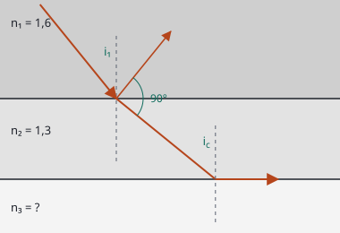
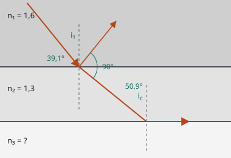

## Enunciado

Un rayo de luz se propaga según muestra el esquema de la figura. Primero incide con un ángulo $i_1$ desde un medio de índice de refracción $n_1 = 1{,}6$ sobre un medio de índice de refracción $n_2 = 1{,}3$, de manera que el rayo reflejado y el rayo refractado forman entre sí un ángulo de 90°. El rayo refractado incide con el ángulo crítico $i_c$ sobre otro medio de índice de refracción $n_3$ desconocido. Determine:

1. Los ángulos de incidencia $i_1$ e $i_c$.
2. El índice de refracción $n_3$.

## Datos

- $n_1 = 1{,}6$, $n_2 = 1{,}3$
- Reflejado y refractado forman 90°
- Las dos superficies son paralelas

## Planteamiento

El reflejado sale con el ángulo $i_1$ respecto a la normal y el refractado con un ángulo $r$. Entre los dos, junto con la superficie, se cumple $i_1 + 90° + r = 180°$, es decir, $r = 90° - i_1$. Llevado a la ley de Snell, sale una ecuación con $i_1$ sola.

Como las superficies son paralelas, el refractado llega a la segunda con el mismo ángulo $r$, que ha de ser el crítico.

## Resolución

### a) Ángulos de incidencia

$$n_1\operatorname{sen}i_1 = n_2\operatorname{sen}(90° - i_1) = n_2\cos i_1
\quad\Longrightarrow\quad
\tan i_1 = \frac{n_2}{n_1} = \frac{1{,}3}{1{,}6} = 0{,}8125$$

$$i_1 = 39{,}1°
\qquad\qquad
i_c = r = 90° - 39{,}1° = 50{,}9°$$

(Este ángulo $i_1$ es el ángulo de Brewster: en él la luz reflejada sale polarizada.)

### b) Índice del tercer medio

En el ángulo crítico el rayo sale rasante:

$$n_2\operatorname{sen}i_c = n_3\operatorname{sen}90°
\quad\Longrightarrow\quad
n_3 = 1{,}3\cdot\operatorname{sen}50{,}9° = 1{,}01$$

El tercer medio tiene un índice muy cercano al del aire. Se llega a lo mismo con $n_3 = n_1\operatorname{sen}i_1$, porque $n\operatorname{sen}\theta$ se conserva a través de superficies paralelas.

## Errores típicos

- Escribir $i_1 + r = 90°$ sin justificarlo con la figura.
- Pensar que el ángulo de llegada a la segunda superficie es distinto de $r$: con superficies paralelas es el mismo.
