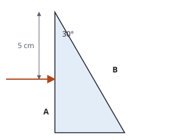
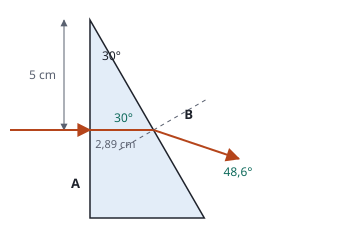

## Enunciado

Sobre la cara A de un prisma de material transparente incide perpendicularmente desde el aire un rayo de luz a una distancia de 5 cm desde el vértice superior, cuyo ángulo es de 30° (ver figura).

1. Calcule el tiempo que tarda el rayo en alcanzar la cara B, y el ángulo de emergencia al aire a través de dicha cara, si el material es un vidrio con un índice de refracción de 1,5.
2. ¿Emergerá el rayo por la cara B si el prisma es de diamante, cuyo índice de refracción es de 2,5? Razone la respuesta.

**Datos:** Velocidad de la luz en el vacío, $c = 3\cdot 10^{8}\ \mathrm{m\,s^{-1}}$; Índice de refracción del aire, $n_\text{aire} = 1$.

## Datos

- Ángulo entre las caras A y B: $30^\circ$
- El rayo entra perpendicular a A, 5 cm por debajo del vértice
- Vidrio: $n = 1{,}5$; diamante: $n = 2{,}5$

## Planteamiento

Con incidencia normal, el rayo entra sin desviarse y recorre en línea recta la distancia hasta la cara B. Esa distancia sale del triángulo rectángulo que forman el vértice, el punto de entrada y el punto de llegada. Dentro del vidrio la luz va a $v = c/n$.

En la cara B, el ángulo de incidencia es el ángulo del prisma (las normales a las dos caras forman el mismo ángulo que las caras), y se aplica la ley de Snell.

## Resolución

### a) Tiempo hasta la cara B y ángulo de emergencia

**Distancia recorrida:**

$$d = 5\tan 30^\circ = 2{,}89\ \mathrm{cm}$$

**Tiempo:**

$$t = \frac{d}{v} = \frac{d\,n}{c} = \frac{0{,}0289\cdot 1{,}5}{3\cdot 10^{8}} = 1{,}44\cdot 10^{-10}\ \mathrm{s}$$

**Ángulo de emergencia.** El rayo llega a la cara B con $30^\circ$ respecto a su normal:

$$1{,}5\operatorname{sen}30^\circ = 1\cdot\operatorname{sen}\theta_2
\quad\Longrightarrow\quad
\operatorname{sen}\theta_2 = 0{,}75
\quad\Longrightarrow\quad
\theta_2 = 48{,}6^\circ$$

### b) Prisma de diamante

$$\operatorname{sen}\theta_2 = 2{,}5\operatorname{sen}30^\circ = 1{,}25$$

No hay ningún ángulo con seno mayor que 1: no existe rayo refractado. El rayo sufre **reflexión total** en la cara B y no emerge por ella.

Dicho de otro modo: el ángulo límite del diamante es $\operatorname{sen}\theta_L = 1/2{,}5$, es decir, 23,6°, y el rayo llega con 30°. Para que saliera, el índice tendría que ser como máximo $1/\operatorname{sen}30^\circ = 2$.

## Errores típicos

- Aplicar Snell en la cara A: el rayo llega perpendicular y no se desvía.
- Usar $c$ en lugar de $c/n$ para el tiempo dentro del vidrio.
- Calcular el ángulo con la calculadora y obtener un error en el caso del diamante sin interpretarlo.
