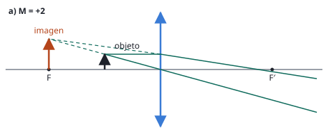
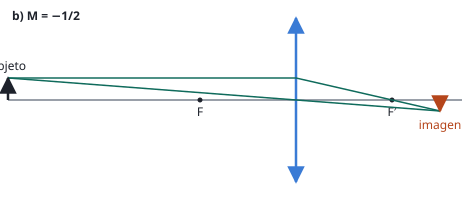

## Enunciado

Determine las posiciones donde debe colocarse un objeto real situado a la izquierda de una lente convergente de potencia 2,5 dioptrías para que el tamaño de la imagen formada por la lente sea:

1. Derecha y el doble que el tamaño del objeto.
2. Invertida y la mitad del tamaño del objeto.

Indique, en cada caso, la naturaleza de la imagen y realice el trazado de rayos correspondiente.

## Datos

- Potencia: $P = 2{,}5\ \mathrm{D}$, así que $f' = 1/2{,}5 = 0{,}40\ \mathrm{m} = 40\ \mathrm{cm}$
- Caso a: $M = +2$; caso b: $M = -1/2$

## Planteamiento

Con $s' = M\,s$, la ecuación de las lentes queda en función de $s$ sola:

$$\frac{1}{M\,s} - \frac{1}{s} = \frac{1}{f'}
\quad\Longrightarrow\quad
s = f'\left(\frac{1}{M} - 1\right)$$

## Resolución

### a) Imagen derecha y doble (M = +2)

$$s = 40\left(\frac12 - 1\right) = -20\ \mathrm{cm}
\qquad\qquad
s' = 2\cdot(-20) = -40\ \mathrm{cm}$$

El objeto está 20 cm a la izquierda, entre el foco y la lente. La imagen es **virtual** (en el mismo lado que el objeto, 40 cm a la izquierda), derecha y mayor: la lente actúa como lupa.

### b) Imagen invertida y mitad (M = −1/2)

$$s = 40\,(-2 - 1) = -120\ \mathrm{cm}
\qquad\qquad
s' = -\frac12\cdot(-120) = 60\ \mathrm{cm}$$

El objeto está 120 cm a la izquierda, más allá de $2f'$. La imagen es **real** (60 cm a la derecha), invertida y menor.

## Errores típicos

- Tomar la potencia como focal o la focal en metros mezclada con distancias en centímetros.
- Usar $M = -2$ en el apartado a: la imagen es derecha.
- En el trazado del caso a, cruzar los rayos reales a la derecha de la lente.
