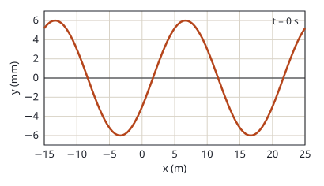

## Enunciado

Una onda armónica unidimensional se propaga a lo largo del sentido positivo del eje $x$ con una velocidad de propagación de $1500\ \mathrm{m\,s^{-1}}$, donde la gráfica adjunta muestra la elongación de la onda para el instante $t = 0\ \mathrm{s}$.

1. Determine el número de onda y la frecuencia angular de dicha onda.
2. Obtenga la expresión matemática que represente dicha onda.

## Datos

- $v = 1500\ \mathrm{m\,s^{-1}}$, hacia $+x$
- De la gráfica: $A = 6\ \mathrm{mm}$, $\lambda = 20\ \mathrm{m}$ (de máximo a máximo) e $y(0, 0) = -3\ \mathrm{mm}$

## Planteamiento

La gráfica es una foto de la cuerda: da la amplitud y la longitud de onda, pero no el periodo, que sale de $v = \lambda/T$.

Para la fase se escribe $y = A\operatorname{sen}(\omega t - kx + \varphi_0)$ y se impone $y(0,0) = -3\ \mathrm{mm}$. Salen dos ángulos; se elige el que reproduce la forma de la gráfica cerca de $x = 0$ (allí $y$ crece con $x$).

## Resolución

### a) Número de onda y frecuencia angular

$$k = \frac{2\pi}{\lambda} = \frac{2\pi}{20} = 0{,}1\pi = 0{,}314\ \mathrm{rad\,m^{-1}}$$

$$f = \frac{v}{\lambda} = \frac{1500}{20} = 75\ \mathrm{Hz}
\qquad\qquad
\omega = 2\pi f = 150\pi = 471\ \mathrm{rad\,s^{-1}}$$

### b) Expresión de la onda

En $t = 0$, $x = 0$:

$$-3 = 6\operatorname{sen}\varphi_0
\quad\Longrightarrow\quad
\operatorname{sen}\varphi_0 = -\frac12
\quad\Longrightarrow\quad
\varphi_0 = -\frac{\pi}{6}\ \text{ o }\ \varphi_0 = \frac{7\pi}{6}$$

En $t = 0$ la onda es $y(x, 0) = 6\operatorname{sen}(\varphi_0 - kx)$. Para elegir, se mira un punto un poco a la derecha, por ejemplo $x = 5\ \mathrm{m}$, donde la gráfica está cerca del máximo:

- Con $-\pi/6$: $y = 6\operatorname{sen}(-\pi/6 - \pi/2) = -5{,}2\ \mathrm{mm}$. No coincide.
- Con $7\pi/6$: $y = 6\operatorname{sen}(7\pi/6 - \pi/2) = +5{,}2\ \mathrm{mm}$. Coincide.

$$y(x,t) = 6\cdot 10^{-3}\operatorname{sen}\left(150\pi\,t - 0{,}1\pi\,x + \frac{7\pi}{6}\right)$$

en unidades del SI ($\varphi_0 = 7\pi/6 = 3{,}67\ \mathrm{rad}$).

## Errores típicos

- Leer $\lambda = 10\ \mathrm{m}$ (distancia entre un máximo y un mínimo, o entre dos ceros seguidos).
- Quedarse con $-\pi/6$ sin comprobar con otro punto de la gráfica.
- Dejar la amplitud en milímetros dentro de una expresión en el SI.
