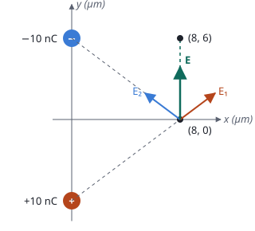

## Enunciado

Dos cargas puntuales de $+10\ \mathrm{nC}$ y $-10\ \mathrm{nC}$ se encuentran situadas en el plano $xy$ en las posiciones $(0, -6)\ \mathrm{\mu m}$ y $(0, 6)\ \mathrm{\mu m}$, respectivamente. Calcule:

1. El campo eléctrico y el potencial en la posición $(8, 0)\ \mathrm{\mu m}$.
2. El trabajo realizado por el campo al trasladar una carga de $+5\ \mathrm{nC}$ desde el punto $(8, 0)\ \mathrm{\mu m}$ hasta la posición $(8, 6)\ \mathrm{\mu m}$.

**Dato:** Constante de la ley de Coulomb, $K = 9\cdot 10^{9}\ \mathrm{N\,m^2\,C^{-2}}$.

## Datos

- $q_1 = +10\cdot 10^{-9}\ \mathrm{C}$ en $(0, -6)\ \mathrm{\mu m}$; $q_2 = -10\cdot 10^{-9}\ \mathrm{C}$ en $(0, 6)\ \mathrm{\mu m}$
- Carga trasladada: $q' = 5\cdot 10^{-9}\ \mathrm{C}$
- $1\ \mathrm{\mu m} = 10^{-6}\ \mathrm{m}$

## Planteamiento

Superposición. En $(8, 0)$ las dos cargas están a la misma distancia, $d = \sqrt{8^2 + 6^2} = 10\ \mathrm{\mu m}$, y tienen el mismo valor absoluto: los dos campos tienen el mismo módulo y, por simetría, sus componentes $x$ se anulan.

El trabajo del campo es $W = q'\,(V_A - V_B)$.

## Resolución

### a) Campo y potencial en (8, 0) μm

$$E_1 = E_2 = K\,\frac{|q|}{d^2} = 9\cdot 10^{9}\cdot\frac{10^{-8}}{(10^{-5})^2} = 9\cdot 10^{11}\ \mathrm{N\,C^{-1}}$$

$\vec E_1$ se aleja de $q_1$, en la dirección $(8, 6)/10$; $\vec E_2$ apunta hacia $q_2$, en la dirección $(-8, 6)/10$:

$$\vec E = 9\cdot 10^{11}\left(\frac{8}{10} - \frac{8}{10}\right)\vec i + 9\cdot 10^{11}\left(\frac{6}{10} + \frac{6}{10}\right)\vec j = 1{,}08\cdot 10^{12}\,\vec j\ \mathrm{N\,C^{-1}}$$

$$V(8,0) = K\,\frac{q_1}{d} + K\,\frac{q_2}{d} = 0$$

porque las cargas son opuestas y están a la misma distancia.

### b) Trabajo del campo de (8, 0) a (8, 6) μm

Distancias desde $(8, 6)$: a $q_1$, $d_1 = \sqrt{8^2 + 12^2} = 14{,}4\ \mathrm{\mu m}$; a $q_2$, $d_2 = 8\ \mathrm{\mu m}$.

$$V(8,6) = 9\cdot 10^{9}\cdot 10^{-8}\left(\frac{1}{14{,}42\cdot 10^{-6}} - \frac{1}{8\cdot 10^{-6}}\right) = -5{,}01\cdot 10^{6}\ \mathrm{V}$$

$$W = q'\,\big(V(8,0) - V(8,6)\big) = 5\cdot 10^{-9}\cdot\big(0 + 5{,}01\cdot 10^{6}\big) = 2{,}50\cdot 10^{-2}\ \mathrm{J}$$

Es positivo: la carga positiva se acerca espontáneamente a la negativa.

## Errores típicos

- No pasar las micras a metros: el campo sale un billón de veces menor.
- Sumar los módulos de los campos sin descomponerlos.
- Calcular el trabajo como $q'(V_B - V_A)$, que es el trabajo de la fuerza externa.
