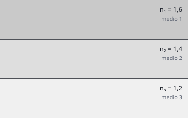
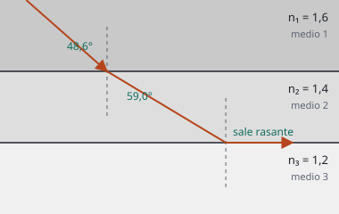

## Enunciado

Un rayo de luz monocromático que se propaga por el medio 1 de índice de refracción $n_1 = 1{,}6$ con una longitud de onda de 460 nm incide sobre la superficie de separación con el medio 2 de índice de refracción $n_2 = 1{,}4$.

1. Calcule la frecuencia y la longitud de onda de la luz cuando se propaga en el segundo medio.
2. Tras este segundo medio, la luz llega a un tercer medio de índice de refracción $n_3 = 1{,}2$ (ver figura). Determine el menor ángulo de incidencia del rayo en la superficie de separación entre los medios 1 y 2 para que, al llegar a la superficie de separación entre los medios 2 y 3, se inicie el fenómeno de la reflexión total. Explique en qué consiste este fenómeno.

**Dato:** Velocidad de la luz en el vacío, $c = 3\cdot 10^{8}\ \mathrm{m\,s^{-1}}$.

## Datos

- $n_1 = 1{,}6$, $n_2 = 1{,}4$, $n_3 = 1{,}2$
- Longitud de onda en el medio 1: $\lambda_1 = 460\ \mathrm{nm}$

## Planteamiento

La frecuencia no cambia al pasar de un medio a otro; lo que cambia es la velocidad, $v = c/n$, y con ella la longitud de onda.

Con superficies paralelas, el ángulo de refracción en una superficie es el de incidencia en la siguiente, así que $n_1\operatorname{sen}\theta_1 = n_2\operatorname{sen}\theta_2 = n_3\operatorname{sen}\theta_3$. La reflexión total empieza cuando $\theta_3 = 90°$.

## Resolución

### a) Frecuencia y longitud de onda en el medio 2

$$f = \frac{v_1}{\lambda_1} = \frac{c}{n_1\,\lambda_1} = \frac{3\cdot 10^{8}}{1{,}6\cdot 460\cdot 10^{-9}} = 4{,}08\cdot 10^{14}\ \mathrm{Hz}$$

Es la misma en los tres medios.

$$\lambda_2 = \frac{n_1}{n_2}\,\lambda_1 = \frac{1{,}6}{1{,}4}\cdot 460 = 526\ \mathrm{nm} = 5{,}26\cdot 10^{-7}\ \mathrm{m}$$

### b) Ángulo mínimo para la reflexión total

Ángulo límite entre los medios 2 y 3:

$$\operatorname{sen}\theta_L = \frac{n_3}{n_2} = \frac{1{,}2}{1{,}4}
\quad\Longrightarrow\quad
\theta_L = 59{,}0°$$

El rayo tiene que llegar al medio 2 con $\theta_2 = 59{,}0°$. En la primera superficie:

$$n_1\operatorname{sen}\theta_1 = n_2\operatorname{sen}\theta_L = n_3
\quad\Longrightarrow\quad
\operatorname{sen}\theta_1 = \frac{1{,}2}{1{,}6} = 0{,}75
\quad\Longrightarrow\quad
\theta_1 = 48{,}6°$$

El medio 2 no influye en el resultado: solo cuentan $n_1$ y $n_3$.

**Reflexión total.** Cuando la luz pasa a un medio de menor índice, se aleja de la normal. Al aumentar el ángulo de incidencia llega un momento, el ángulo límite, en que el rayo refractado sale rasante (90°). Para ángulos mayores ya no hay rayo refractado: toda la luz se refleja y vuelve al primer medio. Solo ocurre al pasar de un medio a otro de índice menor.

## Errores típicos

- Pensar que la frecuencia cambia de un medio a otro.
- Dar el ángulo límite (59,0°) como respuesta: se pide el ángulo en la primera superficie.
- Escribir el ángulo límite con $n_2/n_3$, que es mayor que 1.
