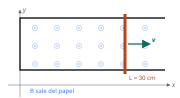

## Enunciado

Una barra conductora, de 30 cm de longitud y paralela al eje $y$, se mueve en el plano $xy$ con una velocidad en el sentido positivo del eje $x$. La barra se mueve sobre unos rieles conductores paralelos en forma de U (ver figura). Perpendicular al plano, hay un campo magnético uniforme $10^{-3}\,\vec k\ \mathrm{T}$. Halle la fuerza electromotriz inducida en la barra en función del tiempo en los siguientes casos:

1. La velocidad de la barra es constante e igual a $10^{2}\,\vec i\ \mathrm{m\,s^{-1}}$.
2. La barra parte del reposo y su aceleración es constante e igual a $5\,\vec i\ \mathrm{m\,s^{-2}}$.

## Datos

- Longitud de la barra: $L = 0{,}30\ \mathrm{m}$
- Campo: $B = 10^{-3}\ \mathrm{T}$, perpendicular al plano
- Caso a: $v = 100\ \mathrm{m\,s^{-1}}$ constante
- Caso b: $v(t) = a\,t$, con $a = 5\ \mathrm{m\,s^{-2}}$

## Planteamiento

El circuito formado por la barra y los rieles tiene un área $L\,x(t)$, que crece al avanzar la barra. El flujo es $\Phi = B\,L\,x(t)$ y la fem inducida, por la ley de Faraday:

$$|\varepsilon| = \frac{\mathrm{d}\Phi}{\mathrm{d}t} = B\,L\,\frac{\mathrm{d}x}{\mathrm{d}t} = B\,L\,v(t)$$

La fem es proporcional a la velocidad: constante en el primer caso y creciente con el tiempo en el segundo.

## Resolución

### a) Velocidad constante

$$|\varepsilon| = B\,L\,v = 10^{-3}\cdot 0{,}30\cdot 100 = 3{,}00\cdot 10^{-2}\ \mathrm{V}$$

Constante en el tiempo.

### b) Aceleración constante desde el reposo

$$v(t) = a\,t = 5\,t
\qquad\Longrightarrow\qquad
|\varepsilon(t)| = B\,L\,a\,t = 10^{-3}\cdot 0{,}30\cdot 5\cdot t = 1{,}5\cdot 10^{-3}\,t\ \mathrm{V}$$

con $t$ en segundos. Crece linealmente desde cero.

En los dos casos, por la ley de Lenz, la corriente inducida se opone al aumento del flujo saliente: circula en sentido horario visto desde arriba (en la barra, hacia $-y$).

## Errores típicos

- En el caso b, usar $\Phi = B\,L\,x$ con $x = \tfrac12 a t^2$ y no derivar: lo que se pide es la fem, no el flujo.
- Escribir la fem del caso b como constante, con la aceleración en lugar de la velocidad.
- Dejar la longitud en centímetros.
