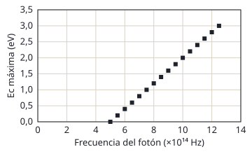

## Enunciado

Se hace incidir un haz de fotones de frecuencia variable sobre una lámina de material metálico, de manera que se emiten electrones cuya energía cinética máxima se mide, obteniendo la gráfica que se adjunta. Determine:

1. El trabajo de extracción del metal en eV.
2. La longitud de onda de De Broglie asociada a los electrones que se emiten, con máxima energía cinética, cuando la frecuencia de los fotones incidentes es de $10\cdot 10^{14}\ \mathrm{Hz}$.

**Datos:** Valor absoluto de la carga del electrón, $e = 1{,}6\cdot 10^{-19}\ \mathrm{C}$; Masa del electrón, $m_e = 9{,}1\cdot 10^{-31}\ \mathrm{kg}$; Constante de Planck, $h = 6{,}63\cdot 10^{-34}\ \mathrm{J\,s}$.

## Datos

De la gráfica:

- Frecuencia umbral (donde empieza la emisión): $f_0 = 5\cdot 10^{14}\ \mathrm{Hz}$
- Con $f = 10\cdot 10^{14}\ \mathrm{Hz}$: $E_{c,\text{máx}} = 2\ \mathrm{eV}$

## Planteamiento

La ecuación de Einstein, $E_{c,\text{máx}} = h f - W_0$, es una recta en la gráfica. Corta al eje de frecuencias en la frecuencia umbral, donde la energía del fotón es justo el trabajo de extracción: $W_0 = h f_0$.

Para De Broglie se lee en la gráfica la energía cinética a la frecuencia pedida, se obtiene la velocidad y $\lambda = h/(m v)$.

## Resolución

### a) Trabajo de extracción

$$W_0 = h\,f_0 = 6{,}63\cdot 10^{-34}\cdot 5\cdot 10^{14} = 3{,}32\cdot 10^{-19}\ \mathrm{J} = 2{,}07\ \mathrm{eV}$$

### b) Longitud de onda de De Broglie a 10·10¹⁴ Hz

En la gráfica, $E_{c,\text{máx}} = 2\ \mathrm{eV} = 3{,}2\cdot 10^{-19}\ \mathrm{J}$:

$$v = \sqrt{\frac{2\,E_c}{m_e}} = \sqrt{\frac{2\cdot 3{,}2\cdot 10^{-19}}{9{,}1\cdot 10^{-31}}} = 8{,}39\cdot 10^{5}\ \mathrm{m\,s^{-1}}$$

$$\lambda_\text{dB} = \frac{h}{m_e\,v} = \frac{6{,}63\cdot 10^{-34}}{9{,}1\cdot 10^{-31}\cdot 8{,}39\cdot 10^{5}} = 8{,}69\cdot 10^{-10}\ \mathrm{m}$$

*Un matiz:* si en lugar de leer la gráfica se calcula $E_c = h(f - f_0)$ con el valor de $h$ dado, sale 2,07 eV y $\lambda = 8{,}54\cdot 10^{-10}\ \mathrm{m}$. La diferencia (un 2 %) se debe a que la pendiente de la gráfica corresponde a $h = 6{,}4\cdot 10^{-34}\ \mathrm{J\,s}$, algo menor que el dato. Las dos respuestas son razonables.

## Errores típicos

- Tomar como trabajo de extracción el valor de la energía cinética a alguna frecuencia.
- Leer la frecuencia sin el factor $10^{14}$ del eje.
- Usar la longitud de onda del fotón en lugar de la del electrón.
