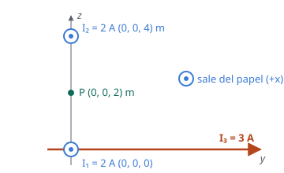

## Enunciado

Se tienen tres hilos indefinidos de corriente (ver figura). Los hilos de intensidades $I_1 = 2\ \mathrm{A}$ e $I_2 = 2\ \mathrm{A}$ son paralelos al eje $x$ y pasan por los puntos $(0, 0, 0)$ y $(0, 0, 4)\ \mathrm{m}$, respectivamente. El tercer hilo, con una intensidad $I_3 = 3\ \mathrm{A}$, pasa por el origen de coordenadas y es paralelo al eje $y$. En todos los casos la corriente va en el sentido positivo de los ejes. Calcule:

1. El campo magnético total creado por los tres hilos en el punto $(0, 0, 2)\ \mathrm{m}$.
2. La fuerza magnética por unidad de longitud que ejerce el hilo de intensidad $I_1$ sobre el hilo de intensidad $I_2$. ¿La fuerza es atractiva o repulsiva?

**Dato:** Permeabilidad magnética del vacío, $\mu_0 = 4\pi\cdot 10^{-7}\ \mathrm{N\,A^{-2}}$.

## Datos

- Hilo 1: eje $x$, $I_1 = 2\ \mathrm{A}$ hacia $+x$
- Hilo 2: paralelo al eje $x$ por $(0, 0, 4)\ \mathrm{m}$, $I_2 = 2\ \mathrm{A}$ hacia $+x$
- Hilo 3: eje $y$, $I_3 = 3\ \mathrm{A}$ hacia $+y$
- Punto P $(0, 0, 2)\ \mathrm{m}$: está a 2 m de cada uno de los tres hilos

## Planteamiento

Cada hilo crea un campo de módulo $\mu_0 I/(2\pi d)$. Para el sentido, en tres dimensiones lo más seguro es el producto vectorial: el campo va según $\vec u_I\times\vec u_r$, donde $\vec u_I$ es el sentido de la corriente y $\vec u_r$ el unitario que va desde el hilo hasta el punto (perpendicular al hilo).

La fuerza por unidad de longitud entre dos hilos paralelos es $\vec F/L = I_2\,\vec u_{2}\times\vec B_1$, con $\vec B_1$ el campo del hilo 1 en la posición del hilo 2.

## Resolución

### a) Campo magnético en (0, 0, 2) m

Los tres hilos están a $d = 2\ \mathrm{m}$ de P.

| Hilo | $\vec u_I$ | $\vec u_r$ (del hilo a P) | $\vec u_I\times\vec u_r$ | Módulo |
|---|---|---|---|---|
| 1 | $\vec i$ | $\vec k$ | $-\vec j$ | $\dfrac{4\pi\cdot 10^{-7}\cdot 2}{2\pi\cdot 2} = 2\cdot 10^{-7}\ \mathrm{T}$ |
| 2 | $\vec i$ | $-\vec k$ | $\vec j$ | $2\cdot 10^{-7}\ \mathrm{T}$ |
| 3 | $\vec j$ | $\vec k$ | $\vec i$ | $\dfrac{4\pi\cdot 10^{-7}\cdot 3}{2\pi\cdot 2} = 3\cdot 10^{-7}\ \mathrm{T}$ |

Los campos de los hilos 1 y 2 son iguales y opuestos (P está justo a mitad de camino entre dos corrientes iguales y paralelas) y se anulan. Queda solo el del hilo 3:

$$\vec B = -2\cdot 10^{-7}\,\vec j + 2\cdot 10^{-7}\,\vec j + 3\cdot 10^{-7}\,\vec i = 3{,}00\cdot 10^{-7}\,\vec i\ \mathrm{T}$$

### b) Fuerza del hilo 1 sobre el hilo 2

Campo del hilo 1 en el hilo 2, a $d = 4\ \mathrm{m}$ en la dirección $+\vec k$:

$$\vec B_1 = \frac{4\pi\cdot 10^{-7}\cdot 2}{2\pi\cdot 4}\,(\vec i\times\vec k) = -1\cdot 10^{-7}\,\vec j\ \mathrm{T}$$

$$\frac{\vec F}{L} = I_2\,\vec i\times\vec B_1 = 2\cdot(-10^{-7})\,(\vec i\times\vec j) = -2{,}00\cdot 10^{-7}\,\vec k\ \mathrm{N\,m^{-1}}$$

La fuerza apunta hacia el hilo 1 (que está por debajo): es **atractiva**, como corresponde a dos corrientes paralelas del mismo sentido.

## Errores típicos

- Equivocar algún sentido al no usar el producto vectorial: en tres dimensiones la regla de la mano «a ojo» falla con facilidad.
- Olvidar el hilo 3 por ser perpendicular a los otros dos.
- Decir que corrientes del mismo sentido se repelen, por analogía con las cargas del mismo signo.
