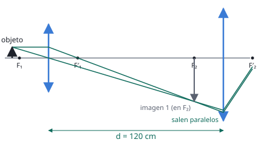

## Enunciado

Un sistema óptico está formado por dos lentes convergentes idénticas de distancia focal 20 cm, que están separadas una cierta distancia desconocida. Un objeto luminoso se sitúa 25 cm a la izquierda de la primera lente.

1. Calcule la distancia que tendrá que haber entre las dos lentes para que la imagen del objeto que forma el sistema óptico se encuentre en el infinito.
2. Realice el correspondiente trazado de rayos.

## Datos

- Dos lentes convergentes: $f' = 20\ \mathrm{cm}$
- Objeto: $s_1 = -25\ \mathrm{cm}$ de la primera lente

## Planteamiento

La segunda lente forma la imagen en el infinito si su objeto (la imagen de la primera) está en su **foco objeto**, 20 cm a su izquierda. Se calcula dónde forma la imagen la primera lente y se coloca la segunda 20 cm más allá.

## Resolución

### a) Distancia entre las lentes

$$\frac{1}{s'_1} = \frac{1}{20} + \frac{1}{-25} = \frac{5 - 4}{100}
\quad\Longrightarrow\quad
s'_1 = 100\ \mathrm{cm}$$

$$d = s'_1 + f' = 100 + 20 = 120\ \mathrm{cm}$$

### b) Trazado de rayos

- Lente 1: el rayo paralelo al eje sale por $F'_1$ y el que pasa por el centro no se desvía. Se cortan en la imagen intermedia, real, invertida y cuatro veces mayor ($M_1 = 100/(-25) = -4$), a 100 cm.
- Esa imagen está en $F_2$. Todos los rayos que salen de un punto del plano focal de la lente 2 emergen **paralelos** entre sí: la imagen final está en el infinito.

## Errores típicos

- Poner la segunda lente a 20 cm de la primera.
- Colocar la imagen intermedia en el foco imagen de la segunda lente.
- En el trazado, hacer que los rayos converjan después de la segunda lente.
