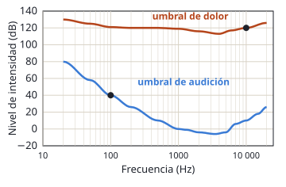

## Enunciado

La gráfica adjunta representa las curvas para el umbral de audición y el umbral de dolor del oído humano medio en función de la frecuencia del sonido. Determine:

1. La distancia máxima a la que debe encontrarse una persona para poder percibir un trueno que emite un sonido de frecuencia 100 Hz con una potencia de 4 W.
2. La potencia sonora máxima que puede emitir una sirena de alarma cuya frecuencia es de 10 000 Hz, situada como mínimo a 5 m de las personas, para no superar el umbral de dolor.

**Dato:** Valor umbral de la intensidad acústica, $I_0 = 10^{-12}\ \mathrm{W\,m^{-2}}$.

## Datos

Leídos en la gráfica (puntos marcados):

- Umbral de audición a 100 Hz: $\beta_a = 40\ \mathrm{dB}$
- Umbral de dolor a 10 000 Hz: $\beta_d = 120\ \mathrm{dB}$

Además: trueno de $P = 4\ \mathrm{W}$; sirena a $d = 5\ \mathrm{m}$ como mínimo.

## Planteamiento

El oído no es igual de sensible a todas las frecuencias: la gráfica dice cuál es el nivel mínimo que se percibe y el máximo que se soporta para cada una. Leído el nivel en la gráfica, se pasa a intensidad y se usa la relación de un foco puntual, $I = P/(4\pi d^2)$.

- Trueno: se deja de oír cuando la intensidad baja al umbral de audición a 100 Hz.
- Sirena: a 5 m, la intensidad no puede pasar del umbral de dolor a 10 000 Hz.

## Resolución

### a) Distancia máxima para oír el trueno

$$I_a = I_0\cdot 10^{40/10} = 10^{-8}\ \mathrm{W\,m^{-2}}$$

$$d = \sqrt{\frac{P}{4\pi\,I_a}} = \sqrt{\frac{4}{4\pi\cdot 10^{-8}}} = 5{,}64\cdot 10^{3}\ \mathrm{m}$$

Unos 5,6 km (sin tener en cuenta la absorción del aire).

### b) Potencia máxima de la sirena

$$I_d = I_0\cdot 10^{120/10} = 1\ \mathrm{W\,m^{-2}}$$

$$P = I_d\cdot 4\pi d^2 = 1\cdot 4\pi\cdot 5^2 = 314\ \mathrm{W}$$

## Errores típicos

- Tomar 0 dB como umbral de audición para todas las frecuencias: a 100 Hz el oído necesita 40 dB.
- Leer la curva equivocada en la gráfica.
- Olvidar que la escala de frecuencias es logarítmica al buscar 100 Hz y 10 000 Hz.
