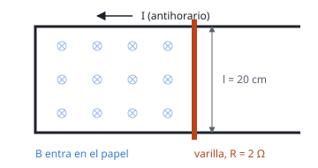

## Enunciado

En una región del espacio existe un campo magnético uniforme de valor 0,5 T que penetra perpendicularmente al plano del papel. En dicha región se sitúa un alambre conductor con forma de U, que tiene una resistencia despreciable, cerrado por una varilla de longitud $l = 20\ \mathrm{cm}$ y resistencia $2\ \Omega$, tal como se muestra en la figura. Calcule:

1. La velocidad, en módulo, dirección y sentido, con la que debemos mover dicha varilla para que se genere una corriente de 1 A en sentido antihorario.
2. La fuerza que es necesario ejercer sobre la varilla para que su velocidad sea constante.

## Datos

- $B = 0{,}5\ \mathrm{T}$, entrando en el papel
- Varilla: $l = 0{,}20\ \mathrm{m}$, $R = 2\ \Omega$
- Corriente deseada: $I = 1\ \mathrm{A}$, antihoraria

## Planteamiento

Al mover la varilla, cambia el área del circuito cerrado por la U, y con ella el flujo. La fem inducida es $|\varepsilon| = B\,l\,v$ y, con la ley de Ohm, $I = |\varepsilon|/R$. De ahí sale el módulo de la velocidad.

El sentido sale de la ley de Lenz. Una corriente antihoraria crea dentro del circuito un campo que sale del papel; eso significa que se opone a un **aumento** del flujo entrante. El área tiene que crecer: la varilla se aleja del extremo cerrado de la U.

Con corriente, la varilla sufre una fuerza magnética $\vec F = I\,\vec l\times\vec B$ que la frena. Para que vaya a velocidad constante hay que compensarla.

## Resolución

### a) Velocidad de la varilla

$$|\varepsilon| = I\,R = 1\cdot 2 = 2\ \mathrm{V}$$

$$v = \frac{|\varepsilon|}{B\,l} = \frac{2}{0{,}5\cdot 0{,}2} = 20{,}0\ \mathrm{m\,s^{-1}}$$

**Sentido:** hacia la **derecha**, alejándose del extremo cerrado de la U, para que el área y el flujo entrante aumenten y la corriente inducida sea antihoraria.

### b) Fuerza para mantener la velocidad constante

En sentido antihorario, la corriente recorre la varilla (lado derecho del circuito) hacia arriba. Con el campo entrando en el papel:

$$F_m = I\,l\,B = 1\cdot 0{,}2\cdot 0{,}5 = 0{,}100\ \mathrm{N}$$

dirigida hacia la izquierda ($\vec j\times(-\vec k) = -\vec i$): frena la varilla. Para que la velocidad sea constante, la fuerza neta debe ser nula, y hay que empujar con

$$F = 0{,}100\ \mathrm{N}\ \text{hacia la derecha}$$

La potencia de esa fuerza, $F\,v = 2\ \mathrm{W}$, es justo la que se disipa en la varilla, $I^2 R = 2\ \mathrm{W}$.

## Errores típicos

- Mover la varilla hacia la izquierda: la corriente saldría en sentido horario.
- Pensar que no hace falta fuerza porque «no hay rozamiento»: la fuerza magnética sobre la corriente inducida frena la varilla.
- Usar la longitud en centímetros.
