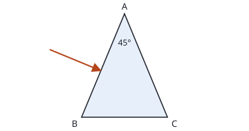
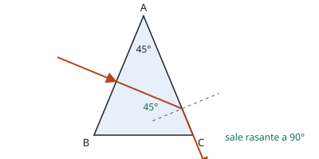

## Enunciado

Sobre la cara AB del prisma de la figura incide perpendicularmente desde el aire un haz de luz monocromática de frecuencia $4{,}6\cdot 10^{14}\ \mathrm{Hz}$.

1. Calcule el índice de refracción que debería tener el prisma para que el ángulo de emergencia del haz de luz a través de la cara AC sea de 90°.
2. Determine las longitudes de onda del haz de luz fuera y dentro del prisma.

**Datos:** Índice de refracción del aire, $n_\text{aire} = 1$; Velocidad de la luz en el vacío, $c = 3\cdot 10^{8}\ \mathrm{m\,s^{-1}}$.

## Datos

- Ángulo del prisma (entre AB y AC): $45^\circ$
- Incidencia normal sobre AB
- Frecuencia: $f = 4{,}6\cdot 10^{14}\ \mathrm{Hz}$

## Planteamiento

Con incidencia normal, el haz entra sin desviarse. En un prisma, el ángulo de refracción en la primera cara más el de incidencia en la segunda suman el ángulo del prisma: $0^\circ + \theta_2 = 45^\circ$. El haz llega a AC formando 45° con su normal.

Que salga con 90° significa que sale rasante: 45° es justo el ángulo límite del prisma.

## Resolución

### a) Índice de refracción

$$n\operatorname{sen}45^\circ = 1\cdot\operatorname{sen}90^\circ
\quad\Longrightarrow\quad
n = \frac{1}{\operatorname{sen}45^\circ} = \sqrt 2 = 1{,}41$$

Con un índice algo mayor, el haz sufriría reflexión total en AC.

### b) Longitudes de onda

$$\lambda_0 = \frac{c}{f} = \frac{3\cdot 10^{8}}{4{,}6\cdot 10^{14}} = 6{,}52\cdot 10^{-7}\ \mathrm{m}$$

$$\lambda = \frac{\lambda_0}{n} = \frac{6{,}52\cdot 10^{-7}}{1{,}41} = 4{,}61\cdot 10^{-7}\ \mathrm{m}$$

## Errores típicos

- Aplicar Snell en la cara AB con 45°: el haz llega perpendicular y no se desvía.
- Tomar el ángulo de incidencia en AC como $90^\circ - 45^\circ$ sin justificar la geometría.
- Cambiar la frecuencia al entrar en el prisma.
