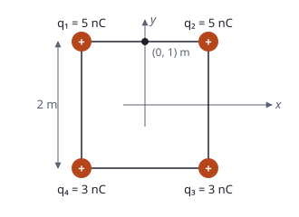

## Enunciado

En los vértices de un cuadrado de lado 2 m y centrado en el origen de coordenadas, se sitúan cuatro cargas eléctricas tal y como se muestra en la figura.

1. Obtenga el campo eléctrico creado por las cargas en el centro del cuadrado.
2. Si desde el centro del cuadrado se lanza un electrón con una velocidad $\vec v = 3\cdot 10^{4}\,\vec j\ \mathrm{m\,s^{-1}}$, calcule el módulo de la velocidad que llevará el electrón en el instante en el que salga del cuadrado por el punto medio del lado superior.

**Datos:** Constante de la ley de Coulomb, $K = 9\cdot 10^{9}\ \mathrm{N\,m^2\,C^{-2}}$; Valor absoluto de la carga del electrón, $e = 1{,}6\cdot 10^{-19}\ \mathrm{C}$; Masa del electrón, $m_e = 9{,}1\cdot 10^{-31}\ \mathrm{kg}$.

## Datos

- $q_1 = q_2 = 5\ \mathrm{nC}$ en $(-1, 1)$ y $(1, 1)\ \mathrm{m}$
- $q_3 = q_4 = 3\ \mathrm{nC}$ en $(1, -1)$ y $(-1, -1)\ \mathrm{m}$
- Distancia de cada vértice al centro: $d = \sqrt 2\ \mathrm{m}$
- Punto de salida: $(0, 1)\ \mathrm{m}$. Está a 1 m de $q_1$ y de $q_2$, y a $\sqrt{1^2 + 2^2} = \sqrt 5\ \mathrm{m}$ de $q_3$ y de $q_4$

## Planteamiento

**Campo.** Las cuatro cargas están a la misma distancia del centro y cada campo apunta alejándose de su carga (todas son positivas). Por simetría, las componentes $x$ se cancelan dos a dos. En $y$, las de arriba empujan hacia abajo y las de abajo hacia arriba; como las de arriba son mayores, gana el campo hacia abajo.

**Velocidad.** Las fuerzas eléctricas son conservativas: se conserva la energía mecánica del electrón,

$$\frac12\,m\,v_i^2 + q\,V_i = \frac12\,m\,v_f^2 + q\,V_f \qquad (q = -e)$$

No hace falta conocer la trayectoria; solo los potenciales del punto de salida y de llegada.

## Resolución

### a) Campo en el centro

Cada componente $y$ vale $K\,q/d^2\cdot\cos 45^\circ$, hacia abajo para las de arriba y hacia arriba para las de abajo:

$$E_y = -\frac{K}{d^2}\,(q_1 + q_2 - q_3 - q_4)\cos 45^\circ = -\frac{9\cdot 10^{9}}{2}\cdot 4\cdot 10^{-9}\cdot 0{,}707 = -12{,}7\ \mathrm{N\,C^{-1}}$$

$$\vec E = -12{,}7\,\vec j\ \mathrm{N\,C^{-1}}$$

### b) Velocidad del electrón al salir por (0, 1) m

**Potenciales:**

$$V_i = V(0, 0) = K\,\frac{5 + 5 + 3 + 3}{\sqrt 2}\cdot 10^{-9} = 102\ \mathrm{V}$$

$$V_f = V(0, 1) = K\left(\frac{5 + 5}{1} + \frac{3 + 3}{\sqrt 5}\right)\cdot 10^{-9} = 90 + 24{,}1 = 114\ \mathrm{V}$$

**Velocidad final.** De la conservación de la energía:

$$v_f = \sqrt{v_i^2 + \frac{2\,e\,(V_f - V_i)}{m_e}} = \sqrt{(3\cdot 10^{4})^2 + \frac{2\cdot 1{,}6\cdot 10^{-19}\cdot 12{,}3}{9{,}1\cdot 10^{-31}}} = 2{,}08\cdot 10^{6}\ \mathrm{m\,s^{-1}}$$

El electrón, con carga negativa, gana energía al ir hacia potenciales mayores: el campo apunta hacia abajo y la fuerza sobre él, hacia arriba. Acaba casi setenta veces más rápido de lo que salió.

## Errores típicos

- Sumar los módulos de los cuatro campos.
- Olvidar el signo negativo de la carga del electrón y obtener que se frena.
- Intentar resolverlo con cinemática: el campo no es uniforme.
- Usar para las cargas de abajo la distancia 2 m en lugar de $\sqrt 5\ \mathrm{m}$.
