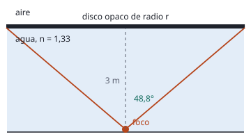

## Enunciado

En el fondo de una piscina de profundidad 3 metros se encuentra un foco que emite luz en todas las direcciones con una longitud de onda de 680 nm en el agua. El haz de luz tiene una longitud de onda de 904,4 nm en el exterior.

1. Calcule el índice de refracción del agua de la piscina.

Ahora se sitúa en la superficie del agua, sobre la vertical del foco, un objeto circular opaco.

2. Determine el valor del radio del objeto para que un observador externo no vea la luz.

**Datos:** Índice de refracción del aire, $n_\text{aire} = 1$; Velocidad de la luz en el vacío, $c = 3\cdot 10^{8}\ \mathrm{m\,s^{-1}}$.

## Datos

- Profundidad: $h = 3\ \mathrm{m}$
- Longitud de onda en el agua: $\lambda_\text{agua} = 680\ \mathrm{nm}$; en el aire: $\lambda_\text{aire} = 904{,}4\ \mathrm{nm}$

## Planteamiento

La frecuencia no cambia al pasar de un medio a otro, así que $n\,\lambda$ es la misma en los dos: el índice sale del cociente de longitudes de onda.

Para el disco: el foco emite en todas direcciones, pero no toda la luz sale al aire. Los rayos que llegan a la superficie con un ángulo mayor que el **ángulo límite** se reflejan totalmente. Los que salen forman un círculo centrado sobre el foco, de radio $r = h\tan\theta_L$; el disco tiene que taparlo entero.

## Resolución

### a) Índice de refracción del agua

$$n_\text{agua}\,\lambda_\text{agua} = n_\text{aire}\,\lambda_\text{aire}
\quad\Longrightarrow\quad
n_\text{agua} = \frac{904{,}4}{680} = 1{,}33$$

### b) Radio del disco

**Ángulo límite agua-aire:**

$$1{,}33\operatorname{sen}\theta_L = 1\cdot\operatorname{sen}90^\circ
\quad\Longrightarrow\quad
\theta_L = 48{,}8^\circ$$

**Radio del círculo de luz:**

$$r = h\tan\theta_L = 3\cdot\tan 48{,}8^\circ = 3{,}42\ \mathrm{m}$$

Un disco de 3,42 m de radio, como mínimo, impide que salga luz del foco.

## Errores típicos

- Calcular el índice al revés, 680/904,4, y obtener un valor menor que 1.
- Usar el seno en lugar de la tangente para el radio.
- Calcular el ángulo límite del aire al agua: la reflexión total solo ocurre al salir del agua.
