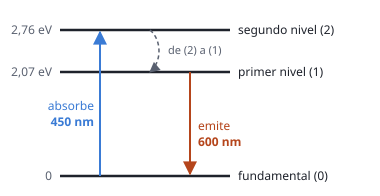

## Enunciado

Un material posee un sistema de tres niveles energéticos electrónicos (nivel fundamental, primer nivel, y segundo nivel). Para que un electrón pase desde el nivel fundamental al segundo nivel, el material absorbe radiación de 450 nm; tras lo cual el material emite radiación de 600 nm debido al decaimiento del primer nivel hasta el fundamental.

1. Determine las diferencias de energía entre el primer nivel y el nivel fundamental, y entre el segundo nivel y el nivel fundamental, expresadas en electrón-voltios.
2. Calcule la energía por unidad de tiempo que produce la emisión si el material emite $4\cdot 10^{15}$ fotones s⁻¹.

**Datos:** Valor absoluto de la carga del electrón, $e = 1{,}6\cdot 10^{-19}\ \mathrm{C}$; Constante de Planck, $h = 6{,}63\cdot 10^{-34}\ \mathrm{J\,s}$; Velocidad de la luz en el vacío, $c = 3\cdot 10^{8}\ \mathrm{m\,s^{-1}}$.

## Datos

- Absorción del nivel 0 al nivel 2: $\lambda_a = 450\ \mathrm{nm}$
- Emisión del nivel 1 al nivel 0: $\lambda_e = 600\ \mathrm{nm}$
- Fotones emitidos por segundo: $N = 4\cdot 10^{15}\ \mathrm{s^{-1}}$

## Planteamiento

Cada vez que un electrón cambia de nivel se absorbe o se emite un fotón cuya energía es justo la diferencia entre los dos niveles:

$$\Delta E = h\,f = \frac{h\,c}{\lambda}$$

La radiación absorbida da la separación entre el nivel 2 y el fundamental; la emitida, la separación entre el nivel 1 y el fundamental.

La energía emitida por segundo (la potencia) es el número de fotones por segundo por la energía de cada uno.

## Resolución

### a) Diferencias de energía

**Nivel 2 – fundamental** (absorción de 450 nm):

$$E_2 - E_0 = \frac{h\,c}{\lambda_a} = \frac{6{,}63\cdot 10^{-34}\cdot 3\cdot 10^{8}}{450\cdot 10^{-9}} = 4{,}42\cdot 10^{-19}\ \mathrm{J} = \frac{4{,}42\cdot 10^{-19}}{1{,}6\cdot 10^{-19}}\ \mathrm{eV} = 2{,}76\ \mathrm{eV}$$

**Nivel 1 – fundamental** (emisión de 600 nm):

$$E_1 - E_0 = \frac{h\,c}{\lambda_e} = \frac{6{,}63\cdot 10^{-34}\cdot 3\cdot 10^{8}}{600\cdot 10^{-9}} = 3{,}32\cdot 10^{-19}\ \mathrm{J} = 2{,}07\ \mathrm{eV}$$

El paso intermedio, del nivel 2 al 1, corresponde a $2{,}76 - 2{,}07 = 0{,}69\ \mathrm{eV}$.

### b) Potencia emitida

$$P = N\,(E_1 - E_0) = 4\cdot 10^{15}\cdot 3{,}32\cdot 10^{-19} = 1{,}33\cdot 10^{-3}\ \mathrm{W}$$

## Errores típicos

- Asignar la longitud de onda absorbida al primer nivel: los 450 nm llevan al electrón hasta el **segundo**.
- Pensar que el fotón emitido tiene la misma energía que el absorbido: se pierde energía en el paso del nivel 2 al 1.
- Dejar las longitudes de onda en nanómetros.
- Calcular la potencia con la energía del fotón absorbido.
