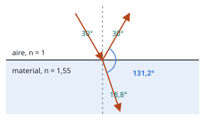

## Enunciado

Un rayo láser, que emite luz de longitud de onda de 488 nm en el vacío, incide desde el aire sobre la superficie plana de un material con un índice de refracción de 1,55. El rayo incidente y el reflejado forman entre sí un ángulo de 60°.

1. Determine la frecuencia y la longitud de onda del rayo luminoso en el aire y dentro del medio material.
2. Calcule el ángulo que formará el rayo refractado en el material con el rayo reflejado en el aire. ¿Existirá algún ángulo de incidencia para el cual el rayo láser sufra reflexión total? Justifique la respuesta.

**Datos:** Índice de refracción del aire, $n_\text{aire} = 1$; Velocidad de la luz en el vacío, $c = 3\cdot 10^{8}\ \mathrm{m\,s^{-1}}$.

## Datos

- Longitud de onda en el vacío (y en el aire, con $n = 1$): $\lambda_0 = 488\ \mathrm{nm}$
- Índice del material: $n = 1{,}55$
- Ángulo entre rayo incidente y reflejado: $60^\circ$

## Planteamiento

Al cambiar de medio, la **frecuencia** de la luz no cambia; cambian la velocidad ($v = c/n$) y la longitud de onda ($\lambda = \lambda_0/n$).

Para el segundo apartado: el ángulo de reflexión es igual al de incidencia, y los dos se miden respecto a la normal; si entre los dos rayos hay 60°, cada uno forma 30° con la normal. La ley de Snell da el ángulo de refracción, y la geometría, el ángulo entre el reflejado y el refractado.

## Resolución

### a) Frecuencia y longitudes de onda

$$f = \frac{c}{\lambda_0} = \frac{3\cdot 10^{8}}{488\cdot 10^{-9}} = 6{,}15\cdot 10^{14}\ \mathrm{Hz}$$

En el aire, $\lambda_\text{aire} = 488\ \mathrm{nm} = 4{,}88\cdot 10^{-7}\ \mathrm{m}$. En el material:

$$\lambda_\text{medio} = \frac{\lambda_0}{n} = \frac{488}{1{,}55} = 315\ \mathrm{nm} = 3{,}15\cdot 10^{-7}\ \mathrm{m}$$

La frecuencia, $6{,}15\cdot 10^{14}\ \mathrm{Hz}$, es la misma en los dos medios.

### b) Ángulo entre el rayo reflejado y el refractado

**Ángulo de incidencia:** $\theta_i + \theta_r = 2\theta_i = 60^\circ$, luego $\theta_i = 30^\circ$.

**Ángulo de refracción:**

$$1\cdot\operatorname{sen}30^\circ = 1{,}55\operatorname{sen}\theta_t
\quad\Longrightarrow\quad
\operatorname{sen}\theta_t = 0{,}323
\quad\Longrightarrow\quad
\theta_t = 18{,}8^\circ$$

**Ángulo entre los dos rayos.** El reflejado forma 30° con la normal hacia arriba y el refractado, 18,8° con la normal hacia abajo, al mismo lado. Como de arriba abajo la normal abarca 180°:

$$\theta = 180^\circ - 30^\circ - 18{,}8^\circ = 131^\circ$$

**¿Reflexión total?** No. La reflexión total exige pasar de un medio a otro de **menor** índice. Si se intenta calcular un ángulo límite del aire al material:

$$1\cdot\operatorname{sen}\theta_L = 1{,}55\operatorname{sen}90^\circ
\quad\Longrightarrow\quad
\operatorname{sen}\theta_L = 1{,}55$$

que no tiene solución. Sea cual sea el ángulo de incidencia, el rayo siempre se refracta hacia el material (aunque una parte de la luz se refleje).

## Errores típicos

- Tomar los 60° como ángulo de incidencia.
- Cambiar la frecuencia al entrar en el material y mantener la longitud de onda.
- Responder que sí hay reflexión total para incidencias grandes: solo ocurre del medio de mayor índice al de menor.
