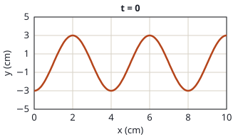
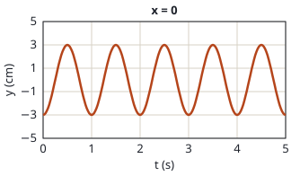

## Enunciado

Una onda armónica transversal se propaga en el sentido positivo del eje $x$. En la figura se tiene una gráfica de la elongación de la onda para $t = 0$ y para $x = 0$. A partir de dicha información determine:

1. La expresión matemática de la onda.
2. La velocidad de propagación de la onda y la velocidad de oscilación del punto $x = 3\ \mathrm{cm}$ en $t = 1\ \mathrm{s}$.

## Datos

Leídos de las gráficas:

- Amplitud: $A = 3\ \mathrm{cm}$ (las dos gráficas oscilan entre $-3$ y $+3$ cm)
- De la gráfica en $t = 0$ (una «foto» de la onda): la forma se repite cada 4 cm, $\lambda = 4\ \mathrm{cm}$
- De la gráfica en $x = 0$ (lo que hace un punto): el movimiento se repite cada segundo, $T = 1\ \mathrm{s}$
- En $x = 0$, $t = 0$ la elongación es $-3\ \mathrm{cm}$: un mínimo
- Sentido de propagación: $+x$

## Planteamiento

Cada gráfica da una de las dos periodicidades de la onda: la de $y$ frente a $x$ da la **longitud de onda**, y la de $y$ frente a $t$, el **periodo**. Confundirlas es el fallo más habitual.

Para una onda que avanza hacia las $x$ positivas:

$$y(x,t) = A\cos(\omega t - kx + \varphi_0)$$

Se elige el coseno porque en el origen e instante inicial la onda está en un extremo, y con el coseno la fase sale inmediata. La fase inicial se ajusta con el valor $y(0,0) = -3\ \mathrm{cm}$.

## Resolución

### a) Expresión de la onda

$$\omega = \frac{2\pi}{T} = 2\pi\ \mathrm{rad\,s^{-1}}
\qquad\qquad
k = \frac{2\pi}{\lambda} = \frac{2\pi}{4} = \frac{\pi}{2}\ \mathrm{rad\,cm^{-1}}$$

**Fase inicial.** En $x = 0$, $t = 0$:

$$y(0,0) = 3\cos\varphi_0 = -3
\quad\Longrightarrow\quad
\cos\varphi_0 = -1
\quad\Longrightarrow\quad
\varphi_0 = \pi\ \mathrm{rad}$$

Al ser un mínimo, solo hay una fase posible y no hace falta mirar la velocidad.

$$y(x,t) = 3\cos\left(2\pi t - \frac{\pi}{2}\,x + \pi\right)\ \mathrm{cm}$$

con $x$ en centímetros y $t$ en segundos. Con la función seno, la misma onda es $y = 3\operatorname{sen}\left(2\pi t - \dfrac{\pi}{2}x + \dfrac{3\pi}{2}\right)\ \mathrm{cm}$.

**Comprobación con la otra gráfica.** En $t = 0$, $y(x, 0) = 3\cos(\pi - \pi x/2) = -3\cos(\pi x/2)$: vale $-3$ en $x = 0$ y $+3$ en $x = 2\ \mathrm{cm}$, como en la figura.

### b) Velocidad de propagación y velocidad de oscilación

**Propagación:**

$$v = \frac{\lambda}{T} = \frac{4\ \mathrm{cm}}{1\ \mathrm{s}} = 4\ \mathrm{cm\,s^{-1}} = 0{,}04\ \mathrm{m\,s^{-1}}$$

**Oscilación.** Derivando la elongación respecto al tiempo:

$$v_y(x,t) = -A\,\omega\operatorname{sen}\left(2\pi t - \frac{\pi}{2}\,x + \pi\right) = -6\pi\operatorname{sen}\left(2\pi t - \frac{\pi}{2}\,x + \pi\right)\ \mathrm{cm\,s^{-1}}$$

En $x = 3\ \mathrm{cm}$, $t = 1\ \mathrm{s}$ la fase vale $2\pi - \dfrac{3\pi}{2} + \pi = \dfrac{3\pi}{2}$, y $\operatorname{sen}(3\pi/2) = -1$:

$$v_y(3;\ 1) = -6\pi\cdot(-1) = 6\pi\ \mathrm{cm\,s^{-1}} = 18{,}8\ \mathrm{cm\,s^{-1}} = 0{,}188\ \mathrm{m\,s^{-1}}$$

Es justo la velocidad máxima, $A\omega$: en ese instante el punto pasa por la posición de equilibrio, subiendo.

## Errores típicos

- Leer el periodo en la gráfica de $y$ frente a $x$, o la longitud de onda en la de $y$ frente a $t$.
- Usar $x = 3$ con $k$ en $\mathrm{rad\,m^{-1}}$, o $x = 0{,}03$ con $k$ en $\mathrm{rad\,cm^{-1}}$: las unidades de $k$ y de $x$ deben ser las mismas.
- Dar como velocidad de oscilación la de propagación.
- Tomar $\varphi_0 = 0$: con coseno, eso daría $+3\ \mathrm{cm}$ en el origen, no $-3$.
