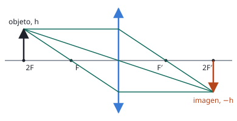

## Enunciado

Se sitúa un objeto de altura $h$ a la izquierda de una lente convergente de distancia focal $f'$. La imagen del objeto que se forma es real, invertida y de igual tamaño.

1. Determine, en función de $f'$, las posiciones del objeto y de la imagen con respecto a la lente.
2. Realice el correspondiente trazado de rayos para la formación de la imagen.

## Datos

- Lente convergente: $f' > 0$
- Altura del objeto: $y = h$
- Imagen invertida y de igual tamaño: $y' = -h$
- Imagen real: se forma a la derecha de la lente, $s' > 0$

## Planteamiento

No hay números: la respuesta tiene que quedar en función de $f'$. Lo que da el enunciado es el **aumento lateral**, porque «invertida y de igual tamaño» significa $M = -1$.

El aumento relaciona $s'$ con $s$, y la ecuación de las lentes delgadas relaciona ambas con $f'$. Son dos ecuaciones con dos incógnitas:

$$M = \frac{y'}{y} = \frac{s'}{s} \qquad\qquad \frac{1}{s'} - \frac{1}{s} = \frac{1}{f'}$$

## Resolución

### a) Posiciones del objeto y de la imagen

$$M = \frac{y'}{y} = \frac{-h}{h} = -1
\quad\Longrightarrow\quad
\frac{s'}{s} = -1
\quad\Longrightarrow\quad
s' = -s$$

Sustituyendo en la ecuación de la lente:

$$\frac{1}{-s} - \frac{1}{s} = \frac{1}{f'}
\quad\Longrightarrow\quad
-\frac{2}{s} = \frac{1}{f'}
\quad\Longrightarrow\quad
s = -2f'$$

$$s' = -s = +2f'$$

El objeto está a **dos veces la distancia focal** a la izquierda de la lente, y la imagen se forma a dos veces la distancia focal a la derecha. Es la única posición del objeto para la que una lente convergente da una imagen del mismo tamaño.

### b) Trazado de rayos

Desde el extremo del objeto se trazan los rayos principales (bastan dos):

1. El que llega paralelo al eje sale pasando por el foco imagen $F'$.
2. El que pasa por el centro de la lente no se desvía.
3. El que pasa por el foco objeto $F$ sale paralelo al eje.

Los tres se cruzan en un punto a $2f'$ a la derecha de la lente y a una altura $-h$: la imagen es real, invertida e igual que el objeto. La figura es simétrica respecto a la lente.

## Errores típicos

- Tomar $M = +1$ por ser «de igual tamaño»: al estar invertida, el aumento es negativo.
- Olvidar el signo de $s$ y escribir $s = 2f'$: el objeto está a la izquierda.
- Colocar el objeto en el foco: ahí los rayos salen paralelos y no se forma imagen.
- Hacer el trazado sin marcar los focos, o con un solo rayo.
