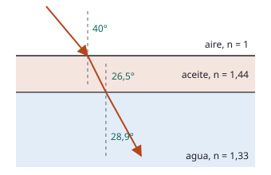

## Enunciado

Un estanque con agua está cubierto con una capa de aceite. Los índices de refracción del agua y del aceite son $n_\text{agua} = 1{,}33$ y $n_\text{aceite} = 1{,}44$, respectivamente.

1. Si un rayo de luz monocromático incide desde el aire hacia el estanque con un ángulo de 40° con respecto a la normal, ¿cuál es el ángulo de refracción del haz en el agua del estanque?
2. Si en el fondo del estanque hay un foco de luz, ¿por debajo de qué ángulo debe incidir el haz de luz del foco con respecto a la normal de la superficie del agua para que la luz salga fuera del estanque hacia el aire?

**Dato:** Índice de refracción del aire, $n_\text{aire} = 1$.

## Datos

- $n_\text{aire} = 1$; $n_\text{aceite} = 1{,}44$; $n_\text{agua} = 1{,}33$
- Ángulo de incidencia desde el aire: $40^\circ$
- Las superficies aire-aceite y aceite-agua son planas y paralelas

## Planteamiento

El rayo cruza dos superficies **paralelas**. Por eso el ángulo con el que se refracta en la primera es el mismo con el que incide en la segunda, y al encadenar las dos leyes de Snell el aceite desaparece:

$$n_\text{aire}\operatorname{sen}\theta_\text{aire} = n_\text{aceite}\operatorname{sen}\theta_\text{aceite} = n_\text{agua}\operatorname{sen}\theta_\text{agua}$$

La cantidad $n\operatorname{sen}\theta$ se conserva de capa en capa. El ángulo en el agua es el mismo que si no hubiera aceite.

En el apartado b el camino es el inverso, del agua al aire. La luz deja de salir cuando el rayo en el aire tendría que formar 90° con la normal.

## Resolución

### a) Ángulo de refracción en el agua

$$1\cdot\operatorname{sen}40^\circ = 1{,}33\operatorname{sen}\theta_\text{agua}
\quad\Longrightarrow\quad
\operatorname{sen}\theta_\text{agua} = \frac{0{,}643}{1{,}33} = 0{,}483
\quad\Longrightarrow\quad
\theta_\text{agua} = 28{,}9^\circ$$

Paso a paso se llega a lo mismo: en el aceite, $\operatorname{sen}\theta_\text{aceite} = 0{,}643/1{,}44$, es decir, $26{,}5^\circ$; y del aceite al agua, $1{,}44\operatorname{sen}26{,}5^\circ = 1{,}33\operatorname{sen}\theta_\text{agua}$, que vuelve a dar 28,9°.

### b) Ángulo máximo para que la luz salga al aire

Para un rayo que sube desde el agua con ángulo $\theta$:

$$1{,}33\operatorname{sen}\theta = 1{,}44\operatorname{sen}\theta_\text{aceite} = 1\cdot\operatorname{sen}\theta_\text{aire}$$

Hay rayo en el aire mientras $\operatorname{sen}\theta_\text{aire} < 1$:

$$1{,}33\operatorname{sen}\theta < 1
\quad\Longrightarrow\quad
\operatorname{sen}\theta < \frac{1}{1{,}33} = 0{,}752
\quad\Longrightarrow\quad
\theta < 48{,}8^\circ$$

La luz del foco sale del estanque solo si incide con menos de 48,8° respecto a la normal.

¿Y no podría quedarse antes, en la superficie agua-aceite? No: el aceite tiene **mayor** índice que el agua, y al pasar a un medio de índice mayor nunca hay reflexión total. La reflexión total se produce en la superficie aceite-aire. Por eso el ángulo que sale es el ángulo límite agua-aire, como si el aceite no estuviera.

## Errores típicos

- Calcular el ángulo límite entre el agua y el aceite: $\operatorname{sen}\theta = 1{,}44/1{,}33$ es mayor que 1 y no tiene solución, que es la forma que tiene la cuenta de decir que ahí no hay reflexión total.
- Dar como respuesta del apartado b el ángulo límite aceite-aire (44,0°): ese es el ángulo **dentro del aceite**, no el del rayo en el agua.
- Medir los ángulos respecto a la superficie en lugar de respecto a la normal.
- Responder al apartado a con el ángulo en el aceite (26,5°).
