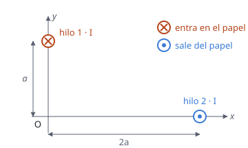

## Enunciado

Dos hilos indefinidos, paralelos al eje $z$, están recorridos por una intensidad de corriente $I = 2\ \mathrm{A}$ en los sentidos indicados en la figura. Uno de los hilos (hilo 1) corta al plano $xy$ en el punto $(0, a)$ y el otro (hilo 2) en el punto $(2a, 0)$, siendo $a = 20\ \mathrm{cm}$. Calcule:

1. El campo magnético creado por ambos hilos en el origen de coordenadas, O$(0, 0)$.
2. La fuerza magnética por unidad de longitud que ejerce el hilo 1 sobre el hilo 2.

**Dato:** Permeabilidad magnética del vacío, $\mu_0 = 4\pi\cdot 10^{-7}\ \mathrm{T\,m\,A^{-1}}$.

## Datos

- $I = 2\ \mathrm{A}$ en los dos hilos; $a = 0{,}20\ \mathrm{m}$
- Hilo 1: en $(0;\ 0{,}20)\ \mathrm{m}$, corriente que **entra** en el papel (sentido $-z$)
- Hilo 2: en $(0{,}40;\ 0)\ \mathrm{m}$, corriente que **sale** del papel (sentido $+z$)
- Distancias al origen: $a$ y $2a$. Distancia entre hilos: $\sqrt{a^2 + (2a)^2} = \sqrt 5\,a = 0{,}447\ \mathrm{m}$

## Planteamiento

El campo de un hilo recto vale $B = \mu_0 I/(2\pi d)$ y sus líneas son circunferencias centradas en el hilo. En cada punto, el campo es **perpendicular** a la línea que une el hilo con el punto, y el sentido de giro lo da la mano derecha:

- corriente que sale del papel: giro **antihorario**;
- corriente que entra: giro **horario**.

El campo total en el origen es la suma vectorial de los dos.

La fuerza entre dos hilos paralelos, por unidad de longitud, es $\mu_0 I_1 I_2/(2\pi d)$. Con corrientes de sentidos **opuestos**, los hilos se **repelen**: la fuerza sobre el hilo 2 lo aleja del hilo 1.

## Resolución

### a) Campo magnético en el origen

**Hilo 1** (entra, giro horario). Está encima del origen, a distancia $a$. Visto desde el hilo, el origen queda «abajo»; en un giro horario, el punto de abajo se mueve hacia la izquierda:

$$\vec B_1 = -\frac{\mu_0\,I}{2\pi\,a}\,\vec i = -\frac{4\pi\cdot 10^{-7}\cdot 2}{2\pi\cdot 0{,}20}\,\vec i = -2{,}00\cdot 10^{-6}\,\vec i\ \mathrm{T}$$

**Hilo 2** (sale, giro antihorario). Está a la derecha del origen, a distancia $2a$. Visto desde el hilo, el origen queda «a la izquierda»; en un giro antihorario, el punto de la izquierda se mueve hacia abajo:

$$\vec B_2 = -\frac{\mu_0\,I}{2\pi\cdot 2a}\,\vec j = -\frac{4\pi\cdot 10^{-7}\cdot 2}{2\pi\cdot 0{,}40}\,\vec j = -1{,}00\cdot 10^{-6}\,\vec j\ \mathrm{T}$$

**Total:**

$$\vec B = (-2{,}00\,\vec i - 1{,}00\,\vec j)\cdot 10^{-6}\ \mathrm{T}$$

Su módulo es $2{,}24\cdot 10^{-6}\ \mathrm{T}$.

### b) Fuerza por unidad de longitud del hilo 1 sobre el hilo 2

**Módulo:**

$$\frac{F}{L} = \frac{\mu_0\,I^2}{2\pi\,d} = \frac{4\pi\cdot 10^{-7}\cdot 2^2}{2\pi\cdot 0{,}447} = 1{,}79\cdot 10^{-6}\ \mathrm{N\,m^{-1}}$$

**Dirección.** Es repulsiva: sobre el hilo 2 apunta en el sentido que va del hilo 1 al hilo 2, es decir, de $(0, a)$ a $(2a, 0)$. Ese vector es $(2a, -a)$, de unitario $(2/\sqrt5,\ -1/\sqrt5)$:

$$\frac{\vec F_{12}}{L} = 1{,}79\cdot 10^{-6}\left(\frac{2}{\sqrt 5}\,\vec i - \frac{1}{\sqrt 5}\,\vec j\right) = (1{,}60\cdot 10^{-6}\,\vec i - 8{,}00\cdot 10^{-7}\,\vec j)\ \mathrm{N\,m^{-1}}$$

El hilo 2 es empujado hacia la derecha y hacia abajo, alejándose del hilo 1.

## Errores típicos

- Dibujar el campo de cada hilo apuntando hacia el hilo o alejándose de él, como si fuera un campo eléctrico. El campo magnético es perpendicular a esa línea.
- Confundir los sentidos de giro de la corriente entrante y la saliente.
- Decir que los hilos se atraen porque las corrientes son «opuestas», por analogía con las cargas. Es al revés: corrientes opuestas se repelen.
- Usar $a$ en centímetros.
