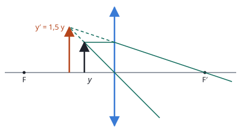
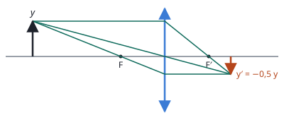

## Enunciado

Se sitúa un objeto a la izquierda de una lente convergente, colocado verticalmente sobre el eje óptico. Determine el aumento lateral de la imagen y realice el correspondiente trazado de rayos para la formación de la imagen, si el objeto se sitúa a:

1. Una distancia de un tercio de la distancia focal de la lente.
2. Una distancia de tres veces la distancia focal de la lente.

## Datos

- Lente convergente, de distancia focal $f' > 0$ (no se da su valor)
- Caso a: $s = -f'/3$
- Caso b: $s = -3f'$

Con el criterio de signos DIN, el objeto está a la izquierda y su posición es negativa.

## Planteamiento

Todo queda en función de $f'$, pero el aumento es un número: al dividir $s'$ entre $s$, la focal se simplifica.

En cada caso se despeja la posición de la imagen de la ecuación de las lentes y se calcula el aumento:

$$\frac{1}{s'} = \frac{1}{f'} + \frac{1}{s} \qquad\qquad M = \frac{s'}{s}$$

Los dos casos están a un lado y otro del foco, y dan los dos comportamientos de una lente convergente: con el objeto **más cerca que el foco** hace de lupa; con el objeto **más lejos**, forma una imagen real.

## Resolución

### a) Objeto a un tercio de la distancia focal

$$\frac{1}{s'} = \frac{1}{f'} + \frac{1}{-f'/3} = \frac{1}{f'} - \frac{3}{f'} = -\frac{2}{f'}
\quad\Longrightarrow\quad
s' = -\frac{f'}{2}$$

$$M = \frac{s'}{s} = \frac{-f'/2}{-f'/3} = \frac32 = 1{,}5$$

La imagen es **virtual** ($s' < 0$, en el lado del objeto), **derecha** ($M > 0$) y **mayor**.

El rayo paralelo al eje sale por el foco imagen $F'$, y el que pasa por el centro no se desvía. A la derecha de la lente los dos rayos se separan; se cortan sus prolongaciones hacia atrás, dibujadas a trazos.

### b) Objeto a tres veces la distancia focal

$$\frac{1}{s'} = \frac{1}{f'} + \frac{1}{-3f'} = \frac{3}{3f'} - \frac{1}{3f'} = \frac{2}{3f'}
\quad\Longrightarrow\quad
s' = \frac{3f'}{2}$$

$$M = \frac{s'}{s} = \frac{3f'/2}{-3f'} = -\frac12 = -0{,}5$$

La imagen es **real** ($s' > 0$), **invertida** ($M < 0$) y de la **mitad de tamaño**.

Aquí los rayos se cruzan de verdad. Se ha añadido el tercer rayo principal: el que pasa por el foco objeto $F$ sale paralelo al eje.

## Errores típicos

- Escribir $s = +f'/3$ o $s = +3f'$.
- Dar las posiciones de la imagen y olvidarse del aumento, que es lo que se pide.
- En el caso a, cruzar los rayos a la derecha de la lente en lugar de prolongarlos hacia atrás.
- Hacer el trazado sin respetar las proporciones: el objeto del caso a debe quedar entre el foco y la lente, y el del caso b, más allá de $2f'$.
