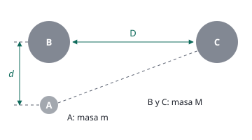

## Enunciado

En un experimento similar al efectuado por Henry Cavendish en 1798 para determinar la constante de gravitación universal, una pequeña esfera, A, de masa $m$ queda situada ante dos esferas, B y C, ambas de la misma masa $M$, de tal modo que los centros de las tres esferas corresponden a los vértices de un triángulo rectángulo de catetos $D$ y $d$, como se ilustra en la figura.

1. ¿Qué relación debe existir entre $D$ y $d$ para que la fuerza de atracción gravitatoria de la esfera C sobre la esfera A sea la décima parte de la atracción de la esfera B sobre A?
2. Si el valor de $M$ es de 10 kg y se encuentra que la atracción de B sobre A es la milmillonésima parte del peso de A en la superficie terrestre, ¿cuánto vale la distancia $d$?

**Datos:** Masa de la Tierra, $M_T = 5{,}97\cdot 10^{24}\ \mathrm{kg}$; Radio de la Tierra, $R_T = 6{,}37\cdot 10^{6}\ \mathrm{m}$.

## Datos

- Distancia de A a B: $d$ (un cateto)
- Distancia de B a C: $D$ (el otro cateto)
- Distancia de A a C: la hipotenusa, $\sqrt{D^2 + d^2}$
- $F_C = F_B/10$
- $M = 10\ \mathrm{kg}$; $F_B = 10^{-9}\cdot\text{peso de A}$
- No se da $G$: tiene que simplificarse

## Planteamiento

Las dos fuerzas sobre A siguen la ley de la gravitación universal, cada una con su distancia. Como B y C tienen la misma masa, al comparar las dos fuerzas se simplifican $G$, $M$ y $m$, y solo quedan las distancias.

En el segundo apartado se compara la atracción de B con el **peso** de A, que no es más que la atracción de la Tierra sobre A: $P = G\,M_T\,m/R_T^2$. De nuevo se simplifican $G$ y $m$. Por eso el enunciado no los da.

## Resolución

### a) Relación entre D y d

$$F_B = \frac{G\,M\,m}{d^2}
\qquad\qquad
F_C = \frac{G\,M\,m}{D^2 + d^2}$$

Imponiendo $F_C = F_B/10$:

$$\frac{G\,M\,m}{D^2 + d^2} = \frac{1}{10}\cdot\frac{G\,M\,m}{d^2}
\quad\Longrightarrow\quad
D^2 + d^2 = 10\,d^2
\quad\Longrightarrow\quad
D^2 = 9\,d^2
\quad\Longrightarrow\quad
D = 3\,d$$

### b) Distancia d

$$\frac{G\,M\,m}{d^2} = 10^{-9}\cdot\frac{G\,M_T\,m}{R_T^2}
\quad\Longrightarrow\quad
d^2 = 10^{9}\,\frac{M}{M_T}\,R_T^2
\quad\Longrightarrow\quad
d = R_T\,\sqrt{\frac{10^{9}\,M}{M_T}}$$

$$d = 6{,}37\cdot 10^{6}\cdot\sqrt{\frac{10^{9}\cdot 10}{5{,}97\cdot 10^{24}}} = 6{,}37\cdot 10^{6}\cdot 4{,}09\cdot 10^{-8} = 0{,}261\ \mathrm{m}$$

Unos 26 cm. Da una idea de lo difícil del experimento: una esfera de 10 kg a un palmo de distancia atrae con una fuerza mil millones de veces menor que el peso.

## Errores típicos

- Tomar $D$ como distancia de A a C. La esfera C está en el otro extremo de la hipotenusa: la distancia es $\sqrt{D^2 + d^2}$.
- Escribir la condición al revés, $F_B = F_C/10$.
- Olvidar la raíz cuadrada al despejar $d$.
- Buscar el valor de $G$: no hace falta.
