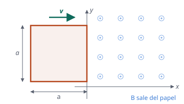
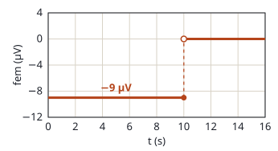

## Enunciado

Una espira cuadrada, de lado $a = 30\ \mathrm{cm}$, penetra con una velocidad constante $\vec v = 3\,\vec i\ \mathrm{cm\,s^{-1}}$, en una zona ($x > 0$) en la que hay un campo magnético $\vec B = 1\cdot 10^{-3}\,\vec k\ \mathrm{T}$. En el instante inicial, la espira está completamente fuera del campo y con uno de sus lados situado en el eje $y$ (ver figura).

1. Represente gráficamente la fem inducida en la espira en función del tiempo.
2. Si la resistencia de la espira es de $10\ \Omega$, obtenga el valor máximo de la intensidad que recorre la espira. Razone cuál será el sentido de la corriente inducida.

## Datos

- Lado: $a = 30\ \mathrm{cm} = 0{,}30\ \mathrm{m}$
- Velocidad: $v = 3\ \mathrm{cm\,s^{-1}} = 0{,}03\ \mathrm{m\,s^{-1}}$, hacia $+x$
- Campo: $B = 10^{-3}\ \mathrm{T}$, según $+z$ (sale del papel), solo en $x > 0$
- Resistencia: $R = 10\ \Omega$
- En $t = 0$ el lado derecho de la espira está en $x = 0$

## Planteamiento

Solo hay fem mientras el flujo **cambia**, y el flujo cambia mientras cambia la parte de la espira que está dentro del campo. Hay dos etapas:

- **Mientras entra.** En un instante $t$, la espira ha metido en el campo una franja de anchura $x = v\,t$ y altura $a$. El flujo crece de manera uniforme.
- **Cuando ya está dentro del todo.** El flujo es constante, $B\,a^2$, y no hay fem, aunque la espira siga moviéndose y haya campo.

El cambio de una etapa a otra ocurre cuando la espira ha avanzado su propio lado: $t = a/v$.

El sentido de la corriente se obtiene con la ley de Lenz.

## Resolución

### a) Fem inducida en función del tiempo

**Tiempo que tarda en entrar:**

$$t_0 = \frac{a}{v} = \frac{0{,}30}{0{,}03} = 10\ \mathrm{s}$$

**Flujo:**

$$\Phi(t) = \begin{cases} B\,a\,v\,t & 0 \le t \le 10\ \mathrm{s} \\[4pt] B\,a^2 & t > 10\ \mathrm{s} \end{cases}$$

**Fem**, derivando ($\varepsilon = -\mathrm{d}\Phi/\mathrm{d}t$):

$$\varepsilon(t) = \begin{cases} -B\,a\,v = -10^{-3}\cdot 0{,}30\cdot 0{,}03 = -9{,}00\cdot 10^{-6}\ \mathrm{V} & 0 \le t \le 10\ \mathrm{s} \\[4pt] 0 & t > 10\ \mathrm{s} \end{cases}$$

La gráfica es un escalón: $9\ \mathrm{\mu V}$ en valor absoluto durante los primeros 10 s, y cero después. El signo menos corresponde a tomar como positivo el sentido del campo; indica que la fem se opone al aumento del flujo.

### b) Intensidad máxima y sentido de la corriente

$$I_\text{máx} = \frac{|\varepsilon|}{R} = \frac{9{,}00\cdot 10^{-6}}{10} = 9{,}00\cdot 10^{-7}\ \mathrm{A}$$

Es la intensidad que circula durante toda la entrada; después es nula.

**Sentido.** Mientras la espira entra, aumenta el flujo de un campo que **sale** del papel. Por la ley de Lenz, la corriente inducida se opone a ese aumento creando, dentro de la espira, un campo que **entra** en el papel. Con la regla de la mano derecha, eso corresponde a una corriente en sentido **horario**.

## Errores típicos

- Dibujar una fem que crece con el tiempo: lo que crece es el flujo. La fem es su pendiente, que es constante.
- Mantener la fem después de los 10 s porque «sigue habiendo campo».
- Calcular la fem como $B\,a^2/t$ con cualquier tiempo, o usar el lado y la velocidad en centímetros.
- Dar el sentido de la corriente oponiéndose al campo sin fijarse en si el flujo aumenta o disminuye.
