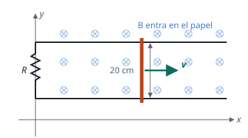

## Enunciado

La figura representa una varilla metálica de 20 cm de longitud, cuyos extremos deslizan sin rozamiento sobre unos raíles horizontales, paralelos al eje $x$, metálicos y de resistencia despreciable. La varilla tiene resistencia despreciable y su velocidad es $\vec v = 2\,\vec i\ \mathrm{m\,s^{-1}}$. Los raíles están conectados en $x = 0$ por una resistencia de valor $R = 0{,}5\ \Omega$. En la región hay un campo magnético uniforme $\vec B = -0{,}4\,\vec k\ \mathrm{T}$. Calcule:

1. La intensidad de la corriente en el circuito formado por la varilla, la resistencia y los tramos de raíl entre ellas.
2. La fuerza $\vec F$ que el campo magnético ejerce sobre la varilla.

## Datos

- Longitud de la varilla: $L = 20\ \mathrm{cm} = 0{,}2\ \mathrm{m}$
- Velocidad: $\vec v = 2\,\vec i\ \mathrm{m\,s^{-1}}$
- Resistencia del circuito: $R = 0{,}5\ \Omega$
- Campo: $\vec B = -0{,}4\,\vec k\ \mathrm{T}$ (entra en el papel)

## Planteamiento

La varilla, los raíles y la resistencia forman un circuito rectangular cuya superficie **crece** al avanzar la varilla. El campo no cambia, pero el flujo sí, porque cambia el área: aparece una fem inducida (ley de Faraday).

Si la varilla está en la posición $x$, el área del circuito es $L\,x$ y el flujo, en valor absoluto, $\Phi = B\,L\,x$. Como $x$ crece a ritmo $v$:

$$|\varepsilon| = \frac{\mathrm{d}\Phi}{\mathrm{d}t} = B\,L\,v$$

El sentido de la corriente se obtiene con la ley de Lenz, y la fuerza sobre la varilla, con la expresión de la fuerza sobre un conductor con corriente: $\vec F = I\,\vec L\times\vec B$.

## Resolución

### a) Intensidad de la corriente

**Fem inducida:**

$$|\varepsilon| = B\,L\,v = 0{,}4\cdot 0{,}2\cdot 2 = 0{,}160\ \mathrm{V}$$

**Intensidad** (ley de Ohm):

$$I = \frac{|\varepsilon|}{R} = \frac{0{,}160}{0{,}5} = 0{,}320\ \mathrm{A}$$

**Sentido** (ley de Lenz). El flujo del campo, que entra en el papel, está aumentando. La corriente inducida se opone a ese aumento creando un campo que **sale** del papel dentro del circuito, y eso exige que circule en sentido **antihorario**. En la varilla, que es el lado derecho del circuito, la corriente va hacia arriba, en el sentido $+y$.

### b) Fuerza del campo sobre la varilla

El vector $\vec L$ tiene la longitud de la varilla y el sentido de la corriente: $\vec L = 0{,}2\,\vec j\ \mathrm{m}$.

$$\vec F = I\,\vec L\times\vec B = 0{,}320\cdot 0{,}2\cdot 0{,}4\ \bigl(\vec j\times(-\vec k)\bigr)$$

Como $\vec j\times\vec k = \vec i$:

$$\vec F = -2{,}56\cdot 10^{-2}\,\vec i\ \mathrm{N}$$

La fuerza va en contra del movimiento: **frena** a la varilla. Es otra forma de ver la ley de Lenz. Para mantener la velocidad constante hay que tirar de la varilla con una fuerza igual hacia la derecha, y la potencia de esa fuerza, $F\,v = 0{,}0512\ \mathrm{W}$, es justo la que se disipa en la resistencia, $I^2R$.

## Errores típicos

- Decir que no hay fem porque el campo es constante: lo que cambia es la superficie del circuito.
- Dar el sentido de la corriente «oponiéndose al campo» en vez de oponerse al **cambio** de flujo.
- Equivocar el producto vectorial y obtener una fuerza a favor del movimiento. Si la fuerza acelerase la varilla, se crearía energía de la nada.
- Usar la longitud en centímetros.
