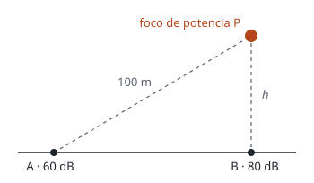

## Enunciado

Un foco sonoro de potencia $P$ se coloca a una altura $h$ sobre el suelo, como ilustra la figura. El nivel de intensidad sonora vale 60 dB en el punto A, a 100 m de distancia del foco, y alcanza 80 dB en el punto B, en el suelo en la vertical del foco.

1. Calcule $P$ y $h$.
2. ¿Cuál sería el nivel de intensidad en el punto B si se agregase sobre él otro foco de igual potencia a una altura de $h/2$?

**Dato:** Intensidad umbral de audición, $I_0 = 10^{-12}\ \mathrm{W\,m^{-2}}$.

## Datos

- Punto A: a $r_A = 100\ \mathrm{m}$ del foco, $\beta_A = 60\ \mathrm{dB}$
- Punto B: a una distancia $h$ del foco (justo debajo), $\beta_B = 80\ \mathrm{dB}$
- Segundo foco: misma potencia, a una altura $h/2$ sobre B

## Planteamiento

Un foco puntual reparte su potencia sobre esferas: $I = P/(4\pi r^2)$. Lo que cuenta es la distancia **al foco**, no la distancia medida sobre el suelo.

- En A se conocen el nivel y la distancia: de ahí sale la potencia.
- En B se conocen el nivel y, ya, la potencia: de ahí sale la distancia, que es la altura $h$.

Al añadir un segundo foco, se suman las **intensidades** que llegan a B de cada uno, y solo al final se pasa a decibelios.

## Resolución

### a) Potencia del foco y altura

**Intensidad en A:**

$$I_A = I_0\cdot 10^{\beta_A/10} = 10^{-12}\cdot 10^{6} = 10^{-6}\ \mathrm{W\,m^{-2}}$$

**Potencia:**

$$P = I_A\cdot 4\pi r_A^2 = 10^{-6}\cdot 4\pi\cdot 100^2 = 0{,}126\ \mathrm{W}$$

**Intensidad en B:**

$$I_B = 10^{-12}\cdot 10^{8} = 10^{-4}\ \mathrm{W\,m^{-2}}$$

**Altura:**

$$I_B = \frac{P}{4\pi h^2}
\quad\Longrightarrow\quad
h = \sqrt{\frac{P}{4\pi\,I_B}} = \sqrt{\frac{0{,}126}{4\pi\cdot 10^{-4}}} = 10{,}0\ \mathrm{m}$$

Se puede ver sin calculadora: 20 dB más significa una intensidad 100 veces mayor, y eso corresponde a una distancia 10 veces menor. Si A está a 100 m, B está a 10 m.

### b) Nivel en B con un segundo foco a h/2

El segundo foco está a la mitad de distancia de B, así que produce allí una intensidad **cuatro veces mayor** que el primero:

$$I_2 = \frac{P}{4\pi\,(h/2)^2} = 4\,\frac{P}{4\pi h^2} = 4\,I_B$$

Intensidad total:

$$I'_B = I_B + 4\,I_B = 5\,I_B = 5\cdot 10^{-4}\ \mathrm{W\,m^{-2}}$$

Nivel:

$$\beta'_B = 10\log\frac{5\cdot 10^{-4}}{10^{-12}} = 80 + 10\log 5 = 87{,}0\ \mathrm{dB}$$

## Errores típicos

- Sumar los niveles de los dos focos (80 dB + 86 dB).
- Pensar que el segundo foco, por ser igual, duplica la intensidad: está más cerca y aporta cuatro veces más.
- Tomar los 100 m como distancia horizontal entre A y B. El enunciado dice que A está a 100 m **del foco**.
- Olvidar el cuadrado de la distancia.
