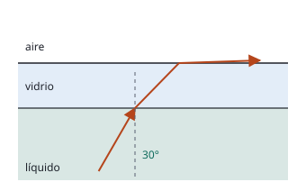

## Enunciado

Una lámina de vidrio se halla sobre un líquido de índice de refracción desconocido. La longitud de onda de la luz en el vidrio se reduce a un 70 % de su valor en el aire. Si se emite luz desde el líquido, los rayos con ángulos de incidencia superiores a 30° en la cara inferior de la lámina no se refractan al aire por su cara superior. Calcule:

1. El índice de refracción del vidrio.
2. El índice de refracción del líquido.

**Dato:** Índice de refracción del aire, $n_\text{aire} = 1$.

## Datos

- $\lambda_\text{vidrio} = 0{,}70\,\lambda_\text{aire}$
- Ángulo de incidencia límite en la superficie líquido-vidrio: $30^\circ$
- Las dos caras de la lámina son paralelas
- $n_\text{aire} = 1$

## Planteamiento

**Índice del vidrio.** Al cambiar de medio, la **frecuencia** de la luz no cambia. Como $v = \lambda f$ y $n = c/v$, la longitud de onda es inversamente proporcional al índice:

$$n_1\,\lambda_1 = n_2\,\lambda_2$$

**Índice del líquido.** El rayo atraviesa dos superficies paralelas, así que el ángulo con el que se refracta al entrar en el vidrio es el mismo con el que llega a su cara superior. Encadenando las dos leyes de Snell:

$$n_\text{líquido}\operatorname{sen}\theta_\text{líquido} = n_\text{vidrio}\operatorname{sen}\theta_\text{vidrio} = n_\text{aire}\operatorname{sen}\theta_\text{aire}$$

Con 30° de incidencia desde el líquido, el rayo está justo en el límite: saldría al aire rasante, a 90°.

## Resolución

### a) Índice de refracción del vidrio

$$n_\text{aire}\,\lambda_\text{aire} = n_\text{vidrio}\,\lambda_\text{vidrio}
\quad\Longrightarrow\quad
n_\text{vidrio} = n_\text{aire}\,\frac{\lambda_\text{aire}}{\lambda_\text{vidrio}} = \frac{1}{0{,}70} = 1{,}43$$

### b) Índice de refracción del líquido

En la situación límite, $\theta_\text{líquido} = 30^\circ$ y $\theta_\text{aire} = 90^\circ$:

$$n_\text{líquido}\operatorname{sen}30^\circ = n_\text{aire}\operatorname{sen}90^\circ
\quad\Longrightarrow\quad
n_\text{líquido} = \frac{1}{\operatorname{sen}30^\circ} = \frac{1}{0{,}5} = 2{,}00$$

El índice del vidrio no interviene: en una lámina de caras paralelas, $n\operatorname{sen}\theta$ se conserva de capa en capa.

**Comprobación paso a paso.** Dentro del vidrio, $\operatorname{sen}\theta_\text{vidrio} = 2{,}00\cdot 0{,}5/1{,}43 = 0{,}70$, es decir, $\theta_\text{vidrio} = 44{,}4^\circ$. Y el ángulo límite vidrio-aire es $\operatorname{sen}\theta_L = 1/1{,}43 = 0{,}70$: el mismo. El rayo llega a la cara superior justo con el ángulo límite.

## Errores típicos

- Invertir la relación y obtener $n_\text{vidrio} = 0{,}70$: un índice menor que 1 no tiene sentido.
- Aplicar los 30° como ángulo límite en la superficie líquido-vidrio, $n_\text{líquido}\operatorname{sen}30^\circ = n_\text{vidrio}$, y obtener 2,86. En esa superficie el rayo sí pasa; donde no pasa es del vidrio al aire.
- Pensar que la frecuencia cambia al entrar en el vidrio.
- Medir los 30° respecto a la superficie en lugar de respecto a la normal.
