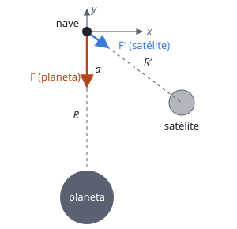

## Enunciado

En su aproximación al planeta Fomalhaut II, el astronauta Rocannon avista Fomalhautillo, satélite natural de Fomalhaut II, según un ángulo $\alpha = 53{,}13^\circ$ con respecto de la radial hacia el planeta (eje $y$). La fuerza total que estos dos cuerpos ejercen sobre Rocannon y su nave, cuya masa conjunta asciende a 8000 kg, vale en ese momento $\vec F = (9{,}5\,\vec i - 66{,}4\,\vec j)\ \mathrm{N}$.

1. ¿A qué distancia $R'$ se encuentra Rocannon del satélite?
2. ¿A qué distancia $R$ se encuentra Rocannon del planeta?

**Datos:** Masa del planeta, $M = 4\cdot 10^{23}\ \mathrm{kg}$; Masa del satélite, $M' = 2\cdot 10^{20}\ \mathrm{kg}$; Constante de Gravitación Universal, $G = 6{,}67\cdot 10^{-11}\ \mathrm{N\,m^2\,kg^{-2}}$.

## Datos

- Masa de la nave: $m = 8000\ \mathrm{kg}$
- Fuerza total: $F_x = 9{,}5\ \mathrm{N}$, $F_y = -66{,}4\ \mathrm{N}$
- $\alpha = 53{,}13^\circ$, con $\operatorname{sen}\alpha = 0{,}8$ y $\cos\alpha = 0{,}6$

## Planteamiento

La fuerza total es la suma vectorial de dos atracciones. La del planeta va a lo largo del eje $y$ (hacia abajo) y no tiene componente $x$. Por tanto, **toda la componente $x$ de la fuerza se debe al satélite**: de ahí sale $R'$. Conocida la fuerza del satélite, se resta su componente $y$ de la total para aislar la del planeta y obtener $R$.

## Resolución

### a) Distancia al satélite

La fuerza del satélite apunta hacia él, formando el ángulo $\alpha$ con el eje $y$ negativo. Su componente $x$ es:

$$F_x = G\,\frac{M'\,m}{R'^2}\operatorname{sen}\alpha
\quad\Longrightarrow\quad
R' = \sqrt{\frac{G\,M'\,m\operatorname{sen}\alpha}{F_x}}$$

$$R' = \sqrt{\frac{6{,}67\cdot 10^{-11}\cdot 2\cdot 10^{20}\cdot 8000\cdot 0{,}8}{9{,}5}} = 3{,}00\cdot 10^{6}\ \mathrm{m}$$

### b) Distancia al planeta

**Componente $y$ de la fuerza del satélite** (hacia abajo). Como $F'_x = F'\operatorname{sen}\alpha$ y $F'_y = F'\cos\alpha$:

$$|F'_y| = \frac{F_x}{\tan\alpha} = \frac{9{,}5}{1{,}333} = 7{,}13\ \mathrm{N}$$

**Fuerza del planeta.** Es el resto de la componente $y$:

$$F_\text{planeta} = 66{,}4 - 7{,}13 = 59{,}3\ \mathrm{N}$$

$$F_\text{planeta} = G\,\frac{M\,m}{R^2}
\quad\Longrightarrow\quad
R = \sqrt{\frac{6{,}67\cdot 10^{-11}\cdot 4\cdot 10^{23}\cdot 8000}{59{,}3}} = 6{,}00\cdot 10^{7}\ \mathrm{m}$$

La nave está a 3000 km del satélite y a 60 000 km del planeta. Aunque el planeta tiene dos mil veces más masa, está veinte veces más lejos, y por eso su fuerza es solo unas cinco veces mayor.

## Errores típicos

- Atribuir toda la componente $y$ al planeta, olvidando la parte del satélite.
- Intercambiar seno y coseno: el ángulo se mide desde el eje $y$.
- Usar el módulo de la fuerza total para una sola de las distancias.
