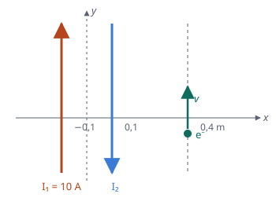

## Enunciado

Dos hilos rectilíneos indefinidos, paralelos al eje $y$, están respectivamente situados en $x = -0{,}1\ \mathrm{m}$ y $x = 0{,}1\ \mathrm{m}$. El primero de ellos conduce una corriente de 10 A en el sentido positivo del eje $y$. Si un electrón viaja en línea recta con velocidad $\vec v = 2\cdot 10^{6}\,\vec j\ \mathrm{m\,s^{-1}}$ a lo largo de $x = 0{,}4\ \mathrm{m}$ sin desviarse, calcule:

1. La intensidad de corriente en el segundo hilo, especificando su sentido.
2. La fuerza que experimentaría un electrón que pasara por el origen de coordenadas con velocidad $\vec v = 2\cdot 10^{6}\,\vec j\ \mathrm{m\,s^{-1}}$.

**Datos:** Permeabilidad magnética del vacío, $\mu_0 = 4\pi\cdot 10^{-7}\ \mathrm{T\,m\,A^{-1}}$; Valor absoluto de la carga del electrón, $e = 1{,}6\cdot 10^{-19}\ \mathrm{C}$.

## Datos

- Hilo 1: $x = -0{,}1\ \mathrm{m}$, $I_1 = 10\ \mathrm{A}$ hacia $+y$
- Hilo 2: $x = 0{,}1\ \mathrm{m}$
- La recta $x = 0{,}4\ \mathrm{m}$ está a 0,5 m del hilo 1 y a 0,3 m del hilo 2
- El origen está a 0,1 m de cada hilo

## Planteamiento

Un electrón en movimiento solo sigue recto si la fuerza magnética sobre él es nula. Como su velocidad es paralela a los hilos y, por tanto, perpendicular al campo que crean, eso exige que el **campo total sea cero** en la recta $x = 0{,}4\ \mathrm{m}$. Esa recta está fuera del espacio entre los hilos, del mismo lado de ambos: los campos solo pueden cancelarse allí si las corrientes son opuestas.

## Resolución

### a) Corriente del segundo hilo

**Sentido.** A la derecha de los dos hilos, dos corrientes del mismo sentido crean campos del mismo sentido, que se suman. Para que se cancelen, la corriente del hilo 2 tiene que ir en sentido contrario: hacia $-y$.

**Valor.** Igualando módulos en $x = 0{,}4\ \mathrm{m}$:

$$\frac{\mu_0\,I_1}{2\pi\cdot 0{,}5} = \frac{\mu_0\,I_2}{2\pi\cdot 0{,}3}
\quad\Longrightarrow\quad
I_2 = I_1\,\frac{0{,}3}{0{,}5} = 6{,}00\ \mathrm{A}$$

### b) Fuerza sobre un electrón en el origen

En el origen, entre los hilos, los campos de dos corrientes opuestas tienen el **mismo sentido**. Con la regla de la mano derecha (o con $\vec u_I\times\vec u_r$): para el hilo 1, $\vec j\times\vec i = -\vec k$; para el hilo 2, $(-\vec j)\times(-\vec i) = -\vec k$. Los dos entran en el papel.

$$B = \frac{\mu_0}{2\pi\cdot 0{,}1}\,(I_1 + I_2) = \frac{4\pi\cdot 10^{-7}\cdot 16}{2\pi\cdot 0{,}1} = 3{,}20\cdot 10^{-5}\ \mathrm{T}
\qquad
\vec B = -3{,}20\cdot 10^{-5}\,\vec k\ \mathrm{T}$$

Fuerza de Lorentz sobre el electrón, con $q = -e$:

$$\vec F = q\,\vec v\times\vec B = (-1{,}6\cdot 10^{-19})\cdot(2\cdot 10^{6}\,\vec j)\times(-3{,}20\cdot 10^{-5}\,\vec k)$$

Como $\vec j\times\vec k = \vec i$ y los dos signos menos se compensan:

$$\vec F = 1{,}6\cdot 10^{-19}\cdot 2\cdot 10^{6}\cdot 3{,}20\cdot 10^{-5}\,\vec i = 1{,}02\cdot 10^{-17}\,\vec i\ \mathrm{N}$$

## Errores típicos

- Suponer corrientes del mismo sentido: el campo no se anularía en $x = 0{,}4\ \mathrm{m}$.
- Restar los campos en el origen. Entre dos hilos con corrientes opuestas, se suman.
- Olvidar el signo negativo de la carga del electrón al aplicar la fuerza de Lorentz.
- Medir las distancias desde el origen en vez de desde cada hilo.
