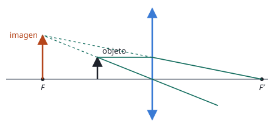

## Enunciado

Un objeto situado 30 cm a la izquierda de una lente produce una imagen con un aumento lateral de $-2$.

1. Obtenga la potencia de la lente.
2. ¿A qué distancia de la lente debe colocarse el objeto para que el aumento pase a ser $+2$? Efectúe el trazado de rayos correspondiente a esta nueva situación.

## Datos

- Primera situación: $s = -30\ \mathrm{cm} = -0{,}30\ \mathrm{m}$, $M = -2$
- Segunda situación: $M = +2$

## Planteamiento

El aumento relaciona las posiciones de imagen y objeto, $s' = M\,s$. Sustituyendo en la ecuación de la lente queda una sola incógnita. El signo del aumento cuenta la historia: con $-2$ la imagen es invertida y real (al otro lado de la lente); con $+2$ es derecha y virtual (en el mismo lado que el objeto), que es lo que hace una **lupa**.

## Resolución

### a) Potencia de la lente

$$s' = M\,s = -2\cdot(-0{,}30) = 0{,}60\ \mathrm{m}$$

$$P = \frac{1}{f'} = \frac{1}{s'} - \frac{1}{s} = \frac{1}{0{,}60} + \frac{1}{0{,}30} = 5{,}00\ \mathrm{D}$$

Lente convergente de focal $f' = 0{,}20\ \mathrm{m}$. El objeto estaba entre $f'$ y $2f'$, donde la imagen es real, invertida y mayor.

### b) Posición del objeto para un aumento +2

Ahora $s' = 2s$:

$$\frac{1}{2s} - \frac{1}{s} = \frac{1}{f'}
\quad\Longrightarrow\quad
-\frac{1}{2s} = \frac{1}{f'}
\quad\Longrightarrow\quad
s = -\frac{f'}{2} = -10{,}0\ \mathrm{cm}$$

El objeto debe colocarse a 10 cm de la lente, a la mitad de la distancia focal. La imagen se forma en $s' = 2s = -20\ \mathrm{cm}$: en el mismo lado que el objeto, virtual, derecha y de doble tamaño.

**Trazado de rayos.** Desde el extremo del objeto:

- el rayo paralelo al eje se refracta pasando por el foco imagen $F'$;
- el rayo que pasa por el centro de la lente no se desvía.

Tras la lente los dos rayos se separan y no se cortan. Sus prolongaciones hacia atrás (líneas de puntos) sí lo hacen, a 20 cm a la izquierda de la lente: ahí ve la imagen quien mira a través de ella.

## Errores típicos

- Calcular la potencia con las distancias en centímetros.
- En el apartado b, colocar el objeto más allá del foco: una lente convergente solo da imágenes derechas con el objeto entre el foco y la lente.
- Dibujar la imagen donde se cruzan los rayos reales, que aquí no se cruzan.
