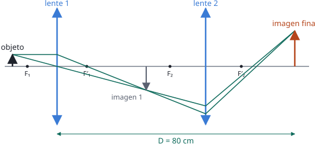

## Enunciado

A una distancia de 15 cm a la izquierda de una lente se sitúa un objeto, cuya imagen se forma 30 cm a la derecha de la lente.

1. Calcule la distancia focal de la lente y el aumento lateral de la imagen.
2. Una segunda lente, de distancia focal 12 cm, se coloca a la derecha de la primera. La imagen final formada por el sistema es, con respecto al objeto original, derecha y de tamaño triple. Determine la distancia entre la primera lente y la imagen final, y elabore el trazado de rayos correspondiente.

## Datos

Con el criterio de signos DIN (distancias positivas hacia la derecha de la lente):

- Primera lente: objeto en $s_1 = -15\ \mathrm{cm}$, imagen en $s'_1 = +30\ \mathrm{cm}$
- Segunda lente: $f'_2 = +12\ \mathrm{cm}$ (convergente)
- Aumento total del sistema: $M = +3$ (derecha y de tamaño triple)

## Planteamiento

El primer apartado es la ecuación de las lentes delgadas aplicada directamente.

En el segundo, el sistema se resuelve por pasos: **la imagen de la primera lente es el objeto de la segunda**, y el aumento total es el producto de los dos aumentos. Como se conoce el aumento total y el de la primera lente, se obtiene el que debe dar la segunda. Ese aumento relaciona $s'_2$ con $s_2$, y la ecuación de la lente hace el resto.

Lo que no se conoce es la separación entre las lentes: sale al final, sabiendo dónde tiene que quedar el objeto de la segunda.

## Resolución

### a) Distancia focal y aumento de la primera lente

$$\frac{1}{f'_1} = \frac{1}{s'_1} - \frac{1}{s_1} = \frac{1}{30} - \frac{1}{-15} = \frac{1}{30} + \frac{2}{30} = \frac{1}{10}
\quad\Longrightarrow\quad
f'_1 = 10\ \mathrm{cm}$$

Es una lente convergente. El aumento lateral:

$$M_1 = \frac{s'_1}{s_1} = \frac{30}{-15} = -2$$

La imagen es real, invertida y de doble tamaño.

### b) Distancia de la primera lente a la imagen final

**Aumento que debe dar la segunda lente:**

$$M = M_1\cdot M_2 = 3
\quad\Longrightarrow\quad
M_2 = \frac{3}{-2} = -1{,}5$$

La segunda lente tiene que volver a invertir la imagen, y por eso la final queda derecha respecto al objeto original.

**Relación entre objeto e imagen en la segunda lente:**

$$M_2 = \frac{s'_2}{s_2} = -1{,}5
\quad\Longrightarrow\quad
s_2 = -\frac{s'_2}{1{,}5} = -\frac23\,s'_2$$

**Ecuación de la segunda lente:**

$$\frac{1}{f'_2} = \frac{1}{s'_2} - \frac{1}{s_2} = \frac{1}{s'_2} + \frac{3}{2\,s'_2} = \frac{5}{2\,s'_2}
\quad\Longrightarrow\quad
s'_2 = \frac52\,f'_2 = \frac52\cdot 12 = 30\ \mathrm{cm}$$

$$s_2 = -\frac23\cdot 30 = -20\ \mathrm{cm}$$

La imagen de la primera lente tiene que quedar 20 cm a la izquierda de la segunda, y la imagen final se forma 30 cm a su derecha.

**Distancia pedida.** Recorriendo el eje desde la primera lente: 30 cm hasta la primera imagen, 20 cm más hasta la segunda lente y 30 cm hasta la imagen final.

$$D = s'_1 + |s_2| + s'_2 = 30 + 20 + 30 = 80\ \mathrm{cm}$$

Las lentes están separadas $30 + 20 = 50\ \mathrm{cm}$.

**Trazado de rayos.** Para un objeto de altura $y$, la primera imagen mide $-2y$ y la final, $+3y$.

- El rayo que sale del extremo del objeto paralelo al eje pasa, tras la primera lente, por su foco imagen $F'_1$.
- El que pasa por el centro de la primera lente no se desvía.
- Los dos se cruzan en el extremo de la primera imagen, siguen hasta la segunda lente y esta los hace converger en el extremo de la imagen final.

## Errores típicos

- Escribir $s_1 = +15\ \mathrm{cm}$: el objeto está a la izquierda y su posición es negativa.
- Tomar $M_2 = +1{,}5$ o repartir el aumento «a ojo». El total es el **producto**: $M_1\cdot M_2$.
- Medir $s_2$ desde la primera lente. Cada lente tiene su propio origen.
- Dar como respuesta 30 cm (la distancia de la segunda lente a la imagen) en lugar de la distancia desde la **primera** lente.
