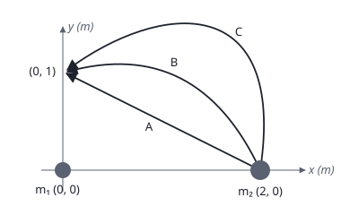
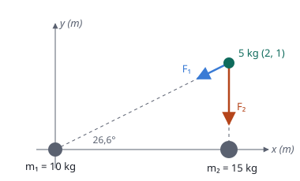

## Enunciado

Dos masas $m_1 = 10\ \mathrm{kg}$ y $m_2 = 15\ \mathrm{kg}$ se encuentran situadas en los puntos $(0, 0)\ \mathrm{m}$ y $(2, 0)\ \mathrm{m}$ respectivamente, del plano $xy$.

1. Calcule la fuerza gravitatoria debida a las masas $m_1$ y $m_2$ que experimentará una masa de 5 kg situada en el punto $(2, 1)\ \mathrm{m}$.
2. Halle el trabajo que realiza el campo gravitatorio creado por la masa $m_1$ cuando la masa $m_2$ se desplaza del punto $(2, 0)\ \mathrm{m}$ al punto $(0, 1)\ \mathrm{m}$ a través de los tres caminos representados en la figura, asumiendo que la masa de 5 kg del apartado anterior no está presente.

**Dato:** Constante de Gravitación Universal, $G = 6{,}67\cdot 10^{-11}\ \mathrm{N\,m^2\,kg^{-2}}$.

## Datos

- $m_1 = 10\ \mathrm{kg}$ en $(0, 0)\ \mathrm{m}$; $m_2 = 15\ \mathrm{kg}$ en $(2, 0)\ \mathrm{m}$
- Tercera masa: $m_3 = 5\ \mathrm{kg}$ en $(2, 1)\ \mathrm{m}$
- Distancia de $m_1$ a $m_3$: $d_{13} = \sqrt{2^2 + 1^2} = \sqrt 5\ \mathrm{m}$
- Distancia de $m_2$ a $m_3$: $d_{23} = 1\ \mathrm{m}$

## Planteamiento

**Apartado a.** La fuerza total sobre $m_3$ es la **suma vectorial** de las fuerzas que le ejercen $m_1$ y $m_2$. Cada una es atractiva: apunta desde $m_3$ hacia la masa que la crea. Se calcula el módulo de cada fuerza, se descompone y se suma por componentes.

**Apartado b.** La fuerza gravitatoria es **conservativa**: el trabajo que hace entre dos puntos no depende del camino, solo de las posiciones inicial y final. No hay que calcular nada sobre las curvas; basta la variación de energía potencial:

$$W = -\Delta E_p = E_{p,\text{inicial}} - E_{p,\text{final}}$$

## Resolución

### a) Fuerza sobre la masa de 5 kg

**Módulos:**

$$F_1 = G\,\frac{m_1\,m_3}{d_{13}^2} = 6{,}67\cdot 10^{-11}\cdot\frac{10\cdot 5}{5} = 6{,}67\cdot 10^{-10}\ \mathrm{N}$$

$$F_2 = G\,\frac{m_2\,m_3}{d_{23}^2} = 6{,}67\cdot 10^{-11}\cdot\frac{15\cdot 5}{1^2} = 5{,}00\cdot 10^{-9}\ \mathrm{N}$$

**Direcciones.** $\vec F_2$ apunta de $(2, 1)$ hacia $(2, 0)$: verticalmente hacia abajo.

$\vec F_1$ apunta de $(2, 1)$ hacia el origen. El vector que va de $m_3$ a $m_1$ es $(-2, -1)$, de módulo $\sqrt 5$, así que su vector unitario es $(-2/\sqrt5,\ -1/\sqrt5)$:

$$\vec F_1 = 6{,}67\cdot 10^{-10}\left(-\frac{2}{\sqrt 5}\,\vec i - \frac{1}{\sqrt 5}\,\vec j\right) = (-5{,}97\cdot 10^{-10}\,\vec i - 2{,}98\cdot 10^{-10}\,\vec j)\ \mathrm{N}$$

$$\vec F_2 = -5{,}00\cdot 10^{-9}\,\vec j\ \mathrm{N}$$

**Suma:**

$$\vec F = \vec F_1 + \vec F_2 = (-5{,}97\cdot 10^{-10}\,\vec i - 5{,}30\cdot 10^{-9}\,\vec j)\ \mathrm{N}$$

El módulo es $5{,}33\cdot 10^{-9}\ \mathrm{N}$. Domina la atracción de $m_2$, que es mayor y está más cerca.

### b) Trabajo al mover m₂ de (2, 0) m a (0, 1) m

La energía potencial del par $m_1$–$m_2$ depende solo de la distancia entre ellas:

- Al principio, $m_2$ está a $r_i = 2\ \mathrm{m}$ de $m_1$.
- Al final, en $(0, 1)\ \mathrm{m}$, está a $r_f = 1\ \mathrm{m}$.

$$W = E_{p,i} - E_{p,f} = -G\,\frac{m_1 m_2}{r_i} - \left(-G\,\frac{m_1 m_2}{r_f}\right) = G\,m_1\,m_2\left(\frac{1}{r_f} - \frac{1}{r_i}\right)$$

$$W = 6{,}67\cdot 10^{-11}\cdot 10\cdot 15\cdot\left(\frac11 - \frac12\right) = 5{,}00\cdot 10^{-9}\ \mathrm{J}$$

**El trabajo es el mismo por los caminos A, B y C**, porque la fuerza gravitatoria es conservativa. Es positivo: $m_2$ acaba más cerca de $m_1$, y acercar dos masas es lo que la gravedad hace por sí sola.

## Errores típicos

- Sumar los módulos de las dos fuerzas como si fueran paralelas.
- Dibujar las fuerzas alejándose de las masas: la gravedad siempre atrae.
- Intentar calcular el trabajo sobre cada curva, o decir que es mayor en el camino más largo.
- Equivocar el signo del trabajo: $W = -\Delta E_p$, no $+\Delta E_p$.

*Nota:* la solución orientativa oficial da $F_y = -5{,}33\cdot 10^{-9}\ \mathrm{N}$; ese valor es en realidad el módulo de la fuerza total. La componente es $-5{,}30\cdot 10^{-9}\ \mathrm{N}$.
