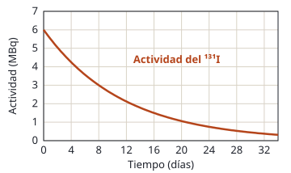

## Enunciado

En la figura se presenta la evolución temporal de la actividad de una muestra que contiene yodo-131 ($^{131}\mathrm{I}$).

1. Halle el tiempo de semidesintegración del isótopo de $^{131}\mathrm{I}$ y su constante de desintegración radiactiva.
2. Calcule el número de núcleos iniciales del isótopo y la masa de $^{131}\mathrm{I}$ que quedará en la muestra al cabo de 60 días.

**Datos:** Masa atómica del $^{131}\mathrm{I}$, $M = 131\ \mathrm{u}$; Número de Avogadro, $N_A = 6{,}02\cdot 10^{23}\ \mathrm{mol^{-1}}$.

## Datos

- De la gráfica: actividad inicial $A_0 = 6\ \mathrm{MBq} = 6\cdot 10^{6}\ \mathrm{Bq}$
- De la gráfica: la actividad vale 3 MBq a los 8 días
- Tiempo del apartado b: $t = 60\ \text{días}$
- Masa molar: $131\ \mathrm{g\,mol^{-1}}$

## Planteamiento

El **periodo de semidesintegración** es el tiempo que tarda la actividad en reducirse a la mitad. Se lee directamente en la gráfica: se busca en qué instante la curva pasa por la mitad de su valor inicial.

Con el periodo se obtiene la constante de desintegración, $\lambda = \ln 2/T_{1/2}$, y con ella todo lo demás:

- La actividad y el número de núcleos están relacionados por $A = \lambda\,N$. Como el becquerel es una desintegración **por segundo**, aquí $\lambda$ tiene que ir en $\mathrm{s^{-1}}$.
- Los núcleos que quedan siguen la ley $N = N_0\,e^{-\lambda t}$.
- Para pasar de núcleos a masa se usa el número de Avogadro.

## Resolución

### a) Periodo de semidesintegración y constante

La actividad inicial es de 6 MBq y la curva pasa por 3 MBq a los 8 días. (Se confirma más adelante: 1,5 MBq a los 16 días.)

$$T_{1/2} = 8\ \text{días} = 8\cdot 86\,400\ \mathrm{s} = 6{,}91\cdot 10^{5}\ \mathrm{s}$$

$$\lambda = \frac{\ln 2}{T_{1/2}} = \frac{0{,}693}{6{,}91\cdot 10^{5}} = 1{,}00\cdot 10^{-6}\ \mathrm{s^{-1}}$$

En días, $\lambda = 0{,}693/8 = 8{,}66\cdot 10^{-2}\ \text{días}^{-1}$.

### b) Núcleos iniciales y masa a los 60 días

**Núcleos iniciales:**

$$N_0 = \frac{A_0}{\lambda} = \frac{6\cdot 10^{6}}{1{,}003\cdot 10^{-6}} = 5{,}98\cdot 10^{12}\ \text{núcleos}$$

**Núcleos a los 60 días.** Sesenta días son $60/8 = 7{,}5$ periodos. Usando $\lambda$ en $\text{días}^{-1}$ y $t$ en días, para que el exponente no tenga unidades:

$$N = N_0\,e^{-\lambda t} = 5{,}98\cdot 10^{12}\cdot e^{-0{,}0866\cdot 60} = 5{,}98\cdot 10^{12}\cdot 5{,}52\cdot 10^{-3} = 3{,}31\cdot 10^{10}\ \text{núcleos}$$

**Masa:**

$$m = \frac{N}{N_A}\cdot M = \frac{3{,}31\cdot 10^{10}}{6{,}02\cdot 10^{23}}\cdot 131 = 7{,}19\cdot 10^{-12}\ \mathrm{g}$$

Queda menos del 1 % de la muestra inicial, como corresponde a siete periodos y medio ($1/2^{7{,}5} = 1/181$).

*Sobre el redondeo:* la solución orientativa oficial redondea $\lambda$ a $1{,}00\cdot 10^{-6}\ \mathrm{s^{-1}}$ antes de seguir y obtiene $N_0 = 6{,}00\cdot 10^{12}$ y $m = 7{,}35\cdot 10^{-12}\ \mathrm{g}$. La diferencia, de un 2 %, viene de ese redondeo dentro de una exponencial; conviene guardar la constante con todas sus cifras en la calculadora.

## Errores típicos

- Calcular $N_0 = A_0/\lambda$ con $\lambda$ en $\text{días}^{-1}$: salen núcleos «por día» y el resultado es 86 400 veces menor.
- Mezclar unidades en el exponente: $\lambda$ en $\mathrm{s^{-1}}$ y $t$ en días.
- Confundir el periodo de semidesintegración (8 días) con la vida media, $\tau = 1/\lambda = 11{,}5$ días.
- Leer el periodo donde la curva llega a cero en lugar de donde vale la mitad.
