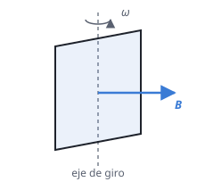

## Enunciado

Una espira cuadrada gira con un período de 0,5 s en presencia de un campo magnético uniforme de 400 mT perpendicular al eje de giro. Sabiendo que en el instante inicial su flujo magnético es máximo e igual a $1{,}6\cdot 10^{-2}\ \mathrm{T\,m^2}$, determine:

1. La longitud del lado de la espira y la expresión del flujo magnético que atraviesa la espira en función del tiempo.
2. La expresión de la fuerza electromotriz (fem) inducida en función del tiempo y su valor en $t = 1\ \mathrm{s}$.

## Datos

- Periodo de giro: $T = 0{,}5\ \mathrm{s}$
- Campo magnético: $B = 400\ \mathrm{mT} = 0{,}4\ \mathrm{T}$
- Flujo en $t = 0$: máximo, $\Phi_\text{máx} = 1{,}6\cdot 10^{-2}\ \mathrm{T\,m^2}$ (o Wb)

## Planteamiento

El flujo a través de la espira es $\Phi = B\,S\cos\theta$, donde $\theta$ es el ángulo entre el campo y la **normal** a la espira. Al girar con velocidad angular constante, ese ángulo crece como $\theta = \omega t + \theta_0$, y el flujo oscila.

- El flujo es máximo cuando la espira está perpendicular al campo ($\theta = 0$), y entonces vale $B\,S$. De ahí sale la superficie, y de ella el lado.
- Que el máximo ocurra en $t = 0$ fija $\theta_0 = 0$.

La fem se obtiene con la ley de Faraday, derivando el flujo: $\varepsilon = -\mathrm{d}\Phi/\mathrm{d}t$.

## Resolución

### a) Lado de la espira y flujo en función del tiempo

**Lado.** Con $S = a^2$:

$$\Phi_\text{máx} = B\,a^2
\quad\Longrightarrow\quad
a = \sqrt{\frac{\Phi_\text{máx}}{B}} = \sqrt{\frac{1{,}6\cdot 10^{-2}}{0{,}4}} = 0{,}20\ \mathrm{m} = 20\ \mathrm{cm}$$

**Velocidad angular:**

$$\omega = \frac{2\pi}{T} = \frac{2\pi}{0{,}5} = 4\pi\ \mathrm{rad\,s^{-1}}$$

**Flujo.** Como en $t = 0$ es máximo, la función es un coseno sin fase inicial:

$$\Phi(t) = \Phi_\text{máx}\cos(\omega t) = 1{,}6\cdot 10^{-2}\cos(4\pi t)\ \mathrm{Wb}$$

con $t$ en segundos.

### b) Fem inducida y su valor en t = 1 s

$$\varepsilon(t) = -\frac{\mathrm{d}\Phi}{\mathrm{d}t} = \Phi_\text{máx}\,\omega\operatorname{sen}(\omega t)$$

La amplitud es

$$\varepsilon_\text{máx} = \Phi_\text{máx}\,\omega = 1{,}6\cdot 10^{-2}\cdot 4\pi = 0{,}201\ \mathrm{V}$$

$$\varepsilon(t) = 0{,}201\operatorname{sen}(4\pi t)\ \mathrm{V}$$

En $t = 1\ \mathrm{s}$:

$$\varepsilon(1) = 0{,}201\operatorname{sen}(4\pi) = 0\ \mathrm{V}$$

Tiene sentido: un segundo son dos vueltas completas, así que la espira está como al principio, con el flujo máximo. Y cuando el flujo pasa por un máximo, en ese instante no está cambiando: la fem es nula.

El signo de la fem depende de qué sentido de la normal se elija como positivo; como el enunciado no lo fija, también es válida la expresión con el signo cambiado.

## Errores típicos

- Escribir el flujo con un seno: en $t = 0$ valdría cero, no el máximo.
- Confundir el periodo con la velocidad angular y poner $\cos(0{,}5\,t)$.
- Olvidar el factor $\omega$ al derivar y dar una fem máxima de $1{,}6\cdot 10^{-2}\ \mathrm{V}$.
- Evaluar $\operatorname{sen}(4\pi)$ con la calculadora en grados.
