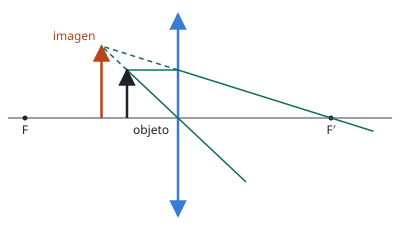
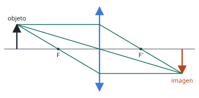

## Enunciado

A una distancia de 3 cm a la izquierda de una lente se sitúa un objeto de 2 cm de altura. La imagen es virtual, derecha y tiene una altura de 3 cm (situación A). A continuación, se aleja el objeto de la lente hasta colocarse a 18 cm a la izquierda de la lente, formando una imagen invertida (situación B).

1. Calcule la distancia focal de la lente y dibuje el esquema de rayos en la situación A.
2. Halle el aumento lateral de la imagen en la situación B y dibuje el esquema de rayos en dicha situación.

## Datos

Con el criterio de signos DIN:

- Situación A: $s_A = -3\ \mathrm{cm}$, $y = 2\ \mathrm{cm}$, $y'_A = +3\ \mathrm{cm}$ (derecha)
- Situación B: $s_B = -18\ \mathrm{cm}$

## Planteamiento

En la situación A no se conoce la posición de la imagen, pero sí su tamaño. El aumento lateral relaciona tamaños y posiciones,

$$M = \frac{y'}{y} = \frac{s'}{s}$$

así que de los tamaños se obtiene $s'_A$, y con $s_A$ y $s'_A$ la ecuación de la lente da la distancia focal. Con la focal ya conocida, la situación B es una aplicación directa de la misma ecuación.

## Resolución

### a) Distancia focal y trazado en la situación A

**Posición de la imagen:**

$$M_A = \frac{y'_A}{y} = \frac{3}{2} = 1{,}5
\quad\Longrightarrow\quad
s'_A = M_A\,s_A = 1{,}5\cdot(-3) = -4{,}5\ \mathrm{cm}$$

El signo negativo confirma que la imagen está en el mismo lado que el objeto: es virtual.

**Distancia focal:**

$$\frac{1}{f'} = \frac{1}{s'_A} - \frac{1}{s_A} = \frac{1}{-4{,}5} - \frac{1}{-3} = -\frac{2}{9} + \frac{3}{9} = \frac19
\quad\Longrightarrow\quad
f' = 9\ \mathrm{cm}$$

Es una lente **convergente**, con el objeto colocado entre el foco y la lente: funciona como una lupa.

- El rayo paralelo al eje sale pasando por el foco imagen $F'$.
- El rayo que pasa por el centro de la lente no se desvía.
- A la derecha de la lente los dos rayos se separan y no llegan a cruzarse. Lo que se cruza son sus **prolongaciones** hacia atrás (a trazos), y ahí está la imagen virtual.

### b) Aumento y trazado en la situación B

$$\frac{1}{s'_B} = \frac{1}{f'} + \frac{1}{s_B} = \frac19 - \frac{1}{18} = \frac{1}{18}
\quad\Longrightarrow\quad
s'_B = 18\ \mathrm{cm}$$

$$M_B = \frac{s'_B}{s_B} = \frac{18}{-18} = -1$$

La imagen es **real** ($s' > 0$), **invertida** ($M < 0$) y del **mismo tamaño** que el objeto: mide $-2\ \mathrm{cm}$. Es el caso particular del objeto situado a dos veces la distancia focal, que da la imagen también a $2f'$.

Aquí los rayos sí se cruzan de verdad a la derecha de la lente. Se ha añadido el tercer rayo principal: el que pasa por el foco objeto $F$ sale paralelo al eje.

## Errores típicos

- Poner $s_A = +3\ \mathrm{cm}$, o $s'_A = +4{,}5\ \mathrm{cm}$: una imagen virtual formada por una lente tiene $s' < 0$.
- Concluir que la lente es divergente porque la imagen es virtual. Una divergente daría una imagen **menor**; aquí es mayor.
- En el trazado de la situación A, cruzar los rayos reales a la derecha en lugar de prolongarlos hacia atrás.
- Usar para la situación B el aumento 1,5 de la situación A: el aumento cambia con la posición del objeto.
