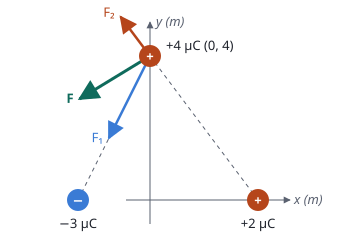

## Enunciado

Dos cargas puntuales de $-3\ \mathrm{\mu C}$ y $+2\ \mathrm{\mu C}$ están situadas en los puntos $(-2, 0)\ \mathrm{m}$ y $(3, 0)\ \mathrm{m}$ del plano $xy$, respectivamente. Calcule:

1. El trabajo que realiza el campo eléctrico para traer una carga de $+4\ \mathrm{\mu C}$ desde el infinito al punto $(0, 4)\ \mathrm{m}$ del plano $xy$.
2. La fuerza total sobre la carga situada en el punto $(0, 4)\ \mathrm{m}$ ejercida por las otras dos.

**Dato:** Constante de Coulomb, $K = 9\cdot 10^{9}\ \mathrm{N\,m^2\,C^{-2}}$.

## Datos

- $q_1 = -3\cdot 10^{-6}\ \mathrm{C}$ en $(-2, 0)\ \mathrm{m}$
- $q_2 = +2\cdot 10^{-6}\ \mathrm{C}$ en $(3, 0)\ \mathrm{m}$
- $q_3 = +4\cdot 10^{-6}\ \mathrm{C}$, que acaba en P $(0, 4)\ \mathrm{m}$
- Distancias a P: $d_1 = \sqrt{2^2 + 4^2} = \sqrt{20}\ \mathrm{m} = 4{,}47\ \mathrm{m}$ y $d_2 = \sqrt{3^2 + 4^2} = 5\ \mathrm{m}$

## Planteamiento

**Trabajo.** El trabajo del campo al mover una carga solo depende de los potenciales inicial y final: $W = q_3\,(V_\text{inicial} - V_\text{final})$. En el infinito el potencial es cero, así que basta el potencial en P, que es la suma **escalar** de los potenciales de las dos cargas, cada uno con su signo.

**Fuerza.** Es la suma **vectorial** de las fuerzas que ejercen $q_1$ y $q_2$ sobre $q_3$. Antes de calcular conviene decidir el sentido de cada una:

- $q_1$ es negativa y $q_3$ positiva: se atraen. $\vec F_1$ apunta de P hacia $q_1$.
- $q_2$ y $q_3$ son positivas: se repelen. $\vec F_2$ apunta de $q_2$ hacia P, y sigue más allá.

## Resolución

### a) Trabajo para traer la carga desde el infinito

Potencial en P:

$$V_P = K\,\frac{q_1}{d_1} + K\,\frac{q_2}{d_2} = 9\cdot 10^{9}\left(\frac{-3\cdot 10^{-6}}{4{,}47} + \frac{2\cdot 10^{-6}}{5}\right) = -6037 + 3600 = -2{,}44\cdot 10^{3}\ \mathrm{V}$$

Trabajo del campo:

$$W_{\infty\to P} = q_3\,(V_\infty - V_P) = 4\cdot 10^{-6}\cdot\bigl(0 - (-2{,}44\cdot 10^{3})\bigr) = 9{,}75\cdot 10^{-3}\ \mathrm{J}$$

Es positivo: en conjunto, el campo atrae a la carga positiva hacia esa zona de potencial negativo, y la trae por sí solo.

### b) Fuerza sobre la carga de +4 μC

**Módulos:**

$$F_1 = K\,\frac{|q_1|\,q_3}{d_1^2} = 9\cdot 10^{9}\cdot\frac{3\cdot 10^{-6}\cdot 4\cdot 10^{-6}}{20} = 5{,}40\cdot 10^{-3}\ \mathrm{N}$$

$$F_2 = K\,\frac{q_2\,q_3}{d_2^2} = 9\cdot 10^{9}\cdot\frac{2\cdot 10^{-6}\cdot 4\cdot 10^{-6}}{25} = 2{,}88\cdot 10^{-3}\ \mathrm{N}$$

**Vectores.** $\vec F_1$ va de P $(0, 4)$ hacia $(-2, 0)$: dirección $(-2, -4)$, de módulo $\sqrt{20}$.

$$\vec F_1 = 5{,}40\cdot 10^{-3}\left(-\frac{2}{\sqrt{20}}\,\vec i - \frac{4}{\sqrt{20}}\,\vec j\right) = (-2{,}41\,\vec i - 4{,}83\,\vec j)\cdot 10^{-3}\ \mathrm{N}$$

$\vec F_2$ va de $(3, 0)$ hacia P $(0, 4)$: dirección $(-3, 4)$, de módulo 5.

$$\vec F_2 = 2{,}88\cdot 10^{-3}\left(-\frac35\,\vec i + \frac45\,\vec j\right) = (-1{,}73\,\vec i + 2{,}30\,\vec j)\cdot 10^{-3}\ \mathrm{N}$$

**Suma:**

$$\vec F = \vec F_1 + \vec F_2 = (-4{,}14\,\vec i - 2{,}53\,\vec j)\cdot 10^{-3}\ \mathrm{N}$$

Su módulo es $4{,}85\cdot 10^{-3}\ \mathrm{N}$.

## Errores típicos

- Tomar los potenciales en valor absoluto: el de la carga negativa es negativo y se resta.
- Calcular el trabajo como $q_3\,V_P$, sin el cambio de signo: saldría negativo.
- Dibujar las dos fuerzas alejándose de las cargas, o las dos acercándose: una atrae y la otra repele.
- Sumar los módulos de las fuerzas en vez de sus componentes.
- No pasar los microculombios a culombios.
