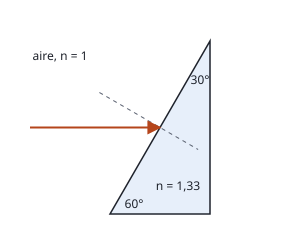
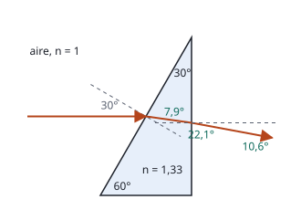

## Enunciado

Un rayo de luz incide horizontalmente desde el aire sobre la cara de un prisma de vidrio con índice de refracción de 1,33. El prisma tiene forma de triángulo rectángulo, con ángulos de 30° y de 60° (ver figura). Determine:

1. El ángulo de refracción del rayo del aire al vidrio.
2. El ángulo de refracción del vidrio al aire en la cara posterior del prisma.

**Dato:** Índice de refracción del aire, $n_\text{aire} = 1$.

## Datos

- Índice del vidrio: $n = 1{,}33$; índice del aire: 1
- Prisma: base horizontal, cara posterior vertical y cara inclinada a 60° de la base (30° de la vertical)
- Rayo incidente: horizontal, sobre la cara inclinada

## Planteamiento

La dificultad no está en la ley de Snell, sino en hallar los ángulos de incidencia, que se miden siempre respecto a la **normal** de cada cara.

- **Cara inclinada.** Forma 30° con la vertical, así que su normal forma 30° con la horizontal. El rayo llega horizontal: incide con 30°.
- **Cara posterior.** Es vertical y su normal es horizontal. El ángulo de incidencia es, sencillamente, lo que el rayo se haya desviado de la horizontal dentro del vidrio.

## Resolución

### a) Refracción al entrar en el vidrio

$$1\cdot\operatorname{sen}30^\circ = 1{,}33\operatorname{sen}\theta_t
\quad\Longrightarrow\quad
\operatorname{sen}\theta_t = \frac{0{,}5}{1{,}33} = 0{,}376
\quad\Longrightarrow\quad
\theta_t = 22{,}1^\circ$$

El rayo se acerca a la normal.

### b) Refracción al salir por la cara posterior

**Dirección del rayo dentro del vidrio.** La normal de la cara inclinada está a 30° de la horizontal y el rayo refractado, a 22,1° de esa normal, del lado de la horizontal. Por tanto, el rayo forma con la horizontal

$$\theta'_i = 30^\circ - 22{,}1^\circ = 7{,}9^\circ$$

y ese es su ángulo de incidencia sobre la cara vertical. El rayo baja ligeramente al avanzar.

(Se llega a lo mismo con el triángulo que forman el rayo y las dos caras: sus ángulos son 30° en el vértice superior, $90^\circ - 22{,}1^\circ = 67{,}9^\circ$ en la entrada y, por tanto, $82{,}1^\circ$ en la salida, que es el complementario de 7,9°.)

**Ley de Snell en la salida.** El ángulo es mucho menor que el ángulo límite vidrio-aire (48,8°), así que el rayo sale:

$$1{,}33\operatorname{sen}7{,}92^\circ = 1\cdot\operatorname{sen}\theta'_t
\quad\Longrightarrow\quad
\operatorname{sen}\theta'_t = 0{,}183
\quad\Longrightarrow\quad
\theta'_t = 10{,}6^\circ$$

El rayo sale desviado 10,6° hacia abajo respecto a su dirección inicial.

## Errores típicos

- Tomar 60° como ángulo de incidencia: ese es el ángulo del rayo con la **cara**, no con la normal.
- Usar 22,1° como ángulo de incidencia en la segunda cara. Las dos caras no son paralelas y sus normales son distintas.
- Aplicar Snell al revés en la salida, dividiendo entre 1,33 en lugar de multiplicar.
- Redondear demasiado pronto: con 7,9° en vez de 7,92° el resultado apenas cambia, pero con 8° ya sale 10,7°.
