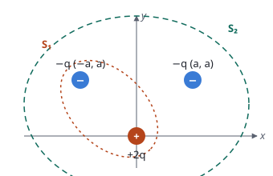

## Enunciado

Tres cargas $-q$, $-q$ y $+2q$ se encuentran situadas en los puntos del plano $(-a, a)$, $(a, a)$ y $(0, 0)$, respectivamente, tal y como se describe en la figura. Determine, en función de la constante de Coulomb, $K$, el valor de la carga, $q$, y la distancia, $a$:

1. La expresión de la fuerza electrostática que se ejerce sobre la carga situada en la posición $(a, a)$ y la expresión del trabajo que habrá realizado esa fuerza electrostática para traer la carga $-q$ desde el infinito a la posición $(a, a)$.
2. El flujo del campo eléctrico a través de las superficies cerradas $S_1$ y $S_2$.

**Dato:** Permitividad eléctrica del vacío, $\varepsilon_0 = 1/(4\pi K)$.

## Datos

- Distancia entre las dos cargas $-q$: $2a$
- Distancia de $+2q$ a la carga de $(a, a)$: $a\sqrt 2$, en una dirección a 45°
- $S_1$ encierra $+2q$ y una $-q$; $S_2$ encierra las tres cargas

## Planteamiento

Es un problema literal: no hay números, pero el método es el de siempre. Sobre la carga de $(a, a)$ actúan dos fuerzas, una repulsiva (de la otra $-q$) y una atractiva (de $+2q$), que se suman por componentes. El trabajo del campo al traerla desde el infinito es menos su energía potencial final. El flujo a través de una superficie cerrada depende solo de la carga que encierra (teorema de Gauss).

## Resolución

### a) Fuerza sobre la carga de (a, a) y trabajo para traerla

**Fuerza de la otra carga $-q$.** Mismo signo: repulsiva, hacia $+x$, a distancia $2a$:

$$\vec F_1 = K\,\frac{q^2}{(2a)^2}\,\vec i = \frac{K q^2}{a^2}\cdot\frac14\,\vec i$$

**Fuerza de $+2q$.** Signo contrario: atractiva, hacia el origen, a distancia $a\sqrt 2$:

$$F_2 = K\,\frac{2q\cdot q}{(a\sqrt 2)^2} = \frac{K q^2}{a^2}
\qquad
\vec F_2 = \frac{K q^2}{a^2}\left(-\frac{\sqrt 2}{2}\,\vec i - \frac{\sqrt 2}{2}\,\vec j\right)$$

**Fuerza total.**

$$\vec F = \frac{K q^2}{a^2}\left[\left(\frac14 - \frac{\sqrt 2}{2}\right)\vec i - \frac{\sqrt 2}{2}\,\vec j\right]
= \frac{K q^2}{a^2}\,(-0{,}457\,\vec i - 0{,}707\,\vec j)$$

**Trabajo.** $W = -\Delta E_p = -E_p(a, a)$, con la energía potencial de la carga $-q$ frente a las otras dos:

$$E_p = K\,\frac{(-q)(-q)}{2a} + K\,\frac{(2q)(-q)}{a\sqrt 2} = \frac{K q^2}{a}\left(\frac12 - \sqrt 2\right)$$

$$W = \frac{K q^2}{a}\left(\sqrt 2 - \frac12\right) = 0{,}914\,\frac{K q^2}{a}$$

Positivo: domina la atracción de $+2q$ y el campo acerca la carga por sí solo.

### b) Flujo a través de S₁ y S₂

Por el teorema de Gauss, $\Phi = Q_\text{int}/\varepsilon_0 = 4\pi K\,Q_\text{int}$.

- **$S_1$** encierra $+2q$ y una $-q$: $Q_\text{int} = +q$.

$$\Phi_{S_1} = \frac{q}{\varepsilon_0} = 4\pi K q$$

- **$S_2$** encierra las tres: $Q_\text{int} = 2q - q - q = 0$.

$$\Phi_{S_2} = 0$$

Que el flujo a través de $S_2$ sea nulo no significa que el campo lo sea en sus puntos: entran tantas líneas como salen.

## Errores típicos

- Tratar las dos fuerzas como atractivas, o las dos como repulsivas.
- Usar $a$ como distancia a la carga del origen: es $a\sqrt 2$.
- En el flujo, intentar integrar el campo sobre la superficie en lugar de contar la carga encerrada.
- Incluir en $S_1$ la carga que queda fuera.
