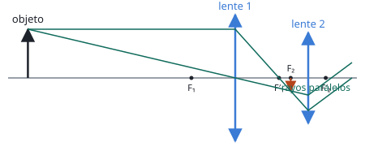

## Enunciado

Un objeto de 2 cm de altura se sitúa a 18 cm a la izquierda de una pantalla. Entre la pantalla y el objeto, a 14,2 cm de este, se sitúa una lente convergente.

1. Determine la distancia focal que debe tener la lente para que se enfoque la imagen del objeto sobre la pantalla y el tamaño de la imagen.
2. A continuación, se retira la pantalla y se sitúa a 5 cm a la derecha de la primera lente otra lente convergente de distancia focal 1,2 cm. ¿Dónde se formará la nueva imagen? Realice el correspondiente trazado de rayos.

## Datos

Con el criterio DIN, medido desde la primera lente:

- Objeto: $s = -14{,}2\ \mathrm{cm}$, $y = 2\ \mathrm{cm}$
- Pantalla: a $18 - 14{,}2 = 3{,}8\ \mathrm{cm}$ a la derecha de la lente, luego $s' = +3{,}8\ \mathrm{cm}$
- Segunda lente: a 5 cm de la primera, $f'_2 = 1{,}2\ \mathrm{cm}$

## Planteamiento

Que la imagen quede enfocada en la pantalla significa que se forma justo allí: se conocen $s$ y $s'$ y la ecuación de la lente da la focal. Al añadir la segunda lente, la imagen de la primera hace de objeto para la segunda, midiendo su posición desde esta.

## Resolución

### a) Distancia focal y tamaño de la imagen

$$\frac{1}{f'} = \frac{1}{s'} - \frac{1}{s} = \frac{1}{3{,}8} + \frac{1}{14{,}2} = 0{,}3336\ \mathrm{cm^{-1}}
\quad\Longrightarrow\quad
f' = 3{,}00\ \mathrm{cm}$$

$$M = \frac{s'}{s} = \frac{3{,}8}{-14{,}2} = -0{,}268
\quad\Longrightarrow\quad
y' = M\,y = -0{,}535\ \mathrm{cm}$$

Imagen real, invertida y de unos 5 mm.

### b) Imagen con la segunda lente

La imagen de la primera lente está a 3,8 cm de ella. La segunda lente está a 5 cm, así que esa imagen queda a su izquierda:

$$s_2 = 3{,}8 - 5 = -1{,}2\ \mathrm{cm}$$

Es exactamente la distancia focal de la segunda lente: el objeto está **en su foco objeto**.

$$\frac{1}{s'_2} = \frac{1}{f'_2} + \frac{1}{s_2} = \frac{1}{1{,}2} - \frac{1}{1{,}2} = 0
\quad\Longrightarrow\quad
s'_2 \to \infty$$

Los rayos salen de la segunda lente **paralelos entre sí** y la imagen se forma en el infinito. Es la disposición de un instrumento pensado para mirar con el ojo relajado.

**Trazado.** Desde el extremo del objeto, el rayo paralelo al eje pasa por $F'_1$ y el rayo central no se desvía; se cortan en la imagen intermedia, que está sobre el plano focal de la segunda lente. Al atravesarla, todos los rayos que proceden de ese punto salen paralelos a la recta que lo une con el centro de la segunda lente.

## Errores típicos

- Tomar $s' = 18\ \mathrm{cm}$: los 18 cm son del objeto a la pantalla, no de la lente a la pantalla.
- Medir la posición del objeto de la segunda lente desde la primera.
- Interpretar $1/s'_2 = 0$ como «no hay imagen» o como $s'_2 = 0$.
