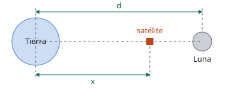

## Enunciado

En la película *Space Cowboys* un amenazador satélite militar orbita alrededor de la Tierra a una altura de 1600 km sobre la superficie terrestre.

1. Calcule la velocidad orbital del satélite y el tiempo que tarda en dar una vuelta completa alrededor de la Tierra. Desprecie en este apartado la interacción gravitatoria de la Luna.
2. Para evitar que el satélite caiga a la Tierra se decide impulsarlo hacia la Luna. Determine la distancia $x$ al centro de la Tierra, tal y como se muestra en la figura, a la que tendrá que llegar el satélite, para que el efecto del campo gravitatorio lunar sea superior al del campo gravitatorio terrestre.

**Datos:** Constante de Gravitación Universal, $G = 6{,}67\cdot 10^{-11}\ \mathrm{N\,m^2\,kg^{-2}}$; Masa de la Tierra, $M_T = 5{,}97\cdot 10^{24}\ \mathrm{kg}$; Radio de la Tierra, $R_T = 6{,}37\cdot 10^{3}\ \mathrm{km}$; Masa de la Luna, $M_L = 7{,}35\cdot 10^{22}\ \mathrm{kg}$; Distancia de la Tierra a la Luna, $d = 3{,}84\cdot 10^{5}\ \mathrm{km}$.

## Datos

- Radio de la órbita: $r = R_T + h = 6{,}37\cdot 10^{6} + 1{,}6\cdot 10^{6} = 7{,}97\cdot 10^{6}\ \mathrm{m}$
- $d = 3{,}84\cdot 10^{8}\ \mathrm{m}$

## Planteamiento

El primer apartado es la órbita circular de siempre. En el segundo, sobre la línea Tierra-Luna los dos campos tiran en sentidos opuestos. Cerca de la Tierra gana el terrestre; a partir del punto en que los módulos se igualan gana el lunar. Hay que encontrar ese punto, que estará mucho más cerca de la Luna porque su masa es 81 veces menor.

## Resolución

### a) Velocidad orbital y periodo

$$v = \sqrt{\frac{G\,M_T}{r}} = \sqrt{\frac{6{,}67\cdot 10^{-11}\cdot 5{,}97\cdot 10^{24}}{7{,}97\cdot 10^{6}}} = 7{,}07\cdot 10^{3}\ \mathrm{m\,s^{-1}}$$

$$T = \frac{2\pi r}{v} = \frac{2\pi\cdot 7{,}97\cdot 10^{6}}{7{,}07\cdot 10^{3}} = 7{,}08\cdot 10^{3}\ \mathrm{s}$$

Casi dos horas (1,97 h).

### b) Punto donde se igualan los dos campos

A una distancia $x$ del centro de la Tierra, la Luna está a $d - x$:

$$G\,\frac{M_T}{x^2} = G\,\frac{M_L}{(d - x)^2}
\quad\Longrightarrow\quad
\frac{x}{d - x} = \sqrt{\frac{M_T}{M_L}} = \sqrt{81{,}2} = 9{,}01$$

$$x = \frac{9{,}01}{1 + 9{,}01}\,d = 0{,}900\cdot 3{,}84\cdot 10^{8} = 3{,}46\cdot 10^{8}\ \mathrm{m}$$

A partir de 346 000 km del centro de la Tierra, es decir, cuando falta la décima parte del camino, la atracción lunar supera a la terrestre.

## Errores típicos

- Usar la altura en lugar de $r = R_T + h$, o dejar las distancias en kilómetros.
- Escribir la distancia a la Luna como $x$ en los dos campos.
- Olvidar la raíz cuadrada y poner el punto a $81/82$ del camino.
