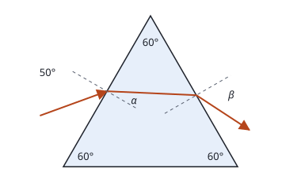

## Enunciado

Un rayo de luz incide sobre la cara izquierda del prisma de la figura, el cual está construido con un material cuyo índice de refracción vale 1,66.

1. Determine los ángulos $\alpha$ y $\beta$ de la trayectoria que sigue el rayo de luz que entra en el prisma desde el aire con un ángulo de incidencia de 50°.
2. Calcule el ángulo límite con el que deberá incidir desde el aire el rayo de luz para que este no emerja del prisma.

**Dato:** Índice de refracción del aire, $n_0 = 1$.

## Datos

- Índice del prisma: $n = 1{,}66$; índice del aire: $n_0 = 1$
- Sección del prisma: triángulo equilátero, con 60° en cada vértice
- Ángulo de incidencia en la cara izquierda: $50^\circ$
- $\alpha$: ángulo de refracción en la primera cara. $\beta$: ángulo de refracción a la salida, en la segunda cara

## Planteamiento

El rayo atraviesa dos superficies y en cada una se aplica la ley de Snell, con los ángulos medidos respecto a la **normal** de esa cara.

Lo que une las dos refracciones es la geometría. Las normales a las dos caras forman entre sí el mismo ángulo que el vértice del prisma, 60°. En el triángulo que forman el rayo interior y las dos normales, el ángulo de refracción en la primera cara, $\alpha$, y el de incidencia en la segunda, $\gamma$, cumplen:

$$\alpha + \gamma = 60^\circ$$

En el apartado b hay que recorrer el camino al revés: el rayo deja de salir cuando en la segunda cara incide con el ángulo límite. De ahí se obtiene $\gamma$, después $\alpha$ y por último el ángulo de incidencia en la primera cara.

## Resolución

### a) Ángulos α y β

**Primera cara** (del aire al prisma):

$$1\cdot\operatorname{sen}50^\circ = 1{,}66\operatorname{sen}\alpha
\quad\Longrightarrow\quad
\operatorname{sen}\alpha = \frac{\operatorname{sen}50^\circ}{1{,}66} = 0{,}461
\quad\Longrightarrow\quad
\alpha = 27{,}5^\circ$$

El rayo se acerca a la normal, como corresponde al entrar en un medio de mayor índice.

**Incidencia en la segunda cara:**

$$\gamma = 60^\circ - \alpha = 60^\circ - 27{,}5^\circ = 32{,}5^\circ$$

**Segunda cara** (del prisma al aire):

$$1{,}66\operatorname{sen}32{,}5^\circ = 1\cdot\operatorname{sen}\beta
\quad\Longrightarrow\quad
\operatorname{sen}\beta = 0{,}892
\quad\Longrightarrow\quad
\beta = 63{,}2^\circ$$

### b) Incidencia para que el rayo no emerja

El rayo no sale por la segunda cara cuando llega a ella con un ángulo igual o mayor que el **ángulo límite** del paso prisma-aire, para el que el rayo refractado saldría rasante ($\beta = 90^\circ$):

$$1{,}66\operatorname{sen}\gamma_L = 1\cdot\operatorname{sen}90^\circ
\quad\Longrightarrow\quad
\operatorname{sen}\gamma_L = \frac{1}{1{,}66} = 0{,}602
\quad\Longrightarrow\quad
\gamma_L = 37{,}0^\circ$$

Para que el rayo llegue a la segunda cara justo con ese ángulo, en la primera tiene que haberse refractado con:

$$\alpha' = 60^\circ - \gamma_L = 60^\circ - 37{,}0^\circ = 23{,}0^\circ$$

Y eso ocurre para un ángulo de incidencia desde el aire:

$$1\cdot\operatorname{sen}\theta_i = 1{,}66\operatorname{sen}23{,}0^\circ = 0{,}647
\quad\Longrightarrow\quad
\theta_i = 40{,}4^\circ$$

¿Hacia qué lado está la condición? Si el ángulo de incidencia **disminuye**, $\alpha$ disminuye y $\gamma = 60^\circ - \alpha$ aumenta, con lo que se supera el ángulo límite. Por tanto, el rayo sufre reflexión total en la segunda cara y no emerge por ella cuando incide con un ángulo **menor que 40,4°**. Encaja con el apartado a: con 50° el rayo sí sale.

## Errores típicos

- Usar $\alpha$ como ángulo de incidencia en la segunda cara, sin pasar por la geometría: el que incide es $\gamma = 60^\circ - \alpha$.
- Buscar el ángulo límite en la primera cara. Al entrar del aire al prisma no puede haber reflexión total; solo al salir.
- Dar el valor de 40,4° sin decir si el rayo deja de salir por encima o por debajo de él.
- Calculadora en radianes.
