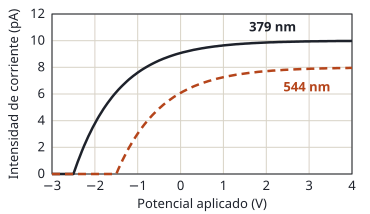

## Enunciado

Para estudiar el efecto fotoeléctrico se registra la intensidad de corriente entre un cierto metal emisor de fotoelectrones y una placa en función del potencial eléctrico aplicado entre ambos, mientras se ilumina el metal fotoemisor con un cierto haz de luz. La gráfica adjunta muestra los datos para luz de 379 nm y 544 nm, donde se observan potenciales de frenado de 2,5 V y de 1,5 V, respectivamente.

1. A partir de los potenciales de frenado, obtenga el valor de la constante de Planck.
2. Indique cuáles serían los valores del potencial de frenado y de la intensidad de corriente máxima para el haz de luz de 379 nm si se disminuyese a la mitad la intensidad del haz.

**Datos:** Velocidad de la luz en el vacío, $c = 3\cdot 10^{8}\ \mathrm{m\,s^{-1}}$; Valor absoluto de la carga del electrón, $e = 1{,}6\cdot 10^{-19}\ \mathrm{C}$.

## Datos

- Luz 1: $\lambda_1 = 379\ \mathrm{nm} = 3{,}79\cdot 10^{-7}\ \mathrm{m}$, potencial de frenado $V_1 = 2{,}5\ \mathrm{V}$
- Luz 2: $\lambda_2 = 544\ \mathrm{nm} = 5{,}44\cdot 10^{-7}\ \mathrm{m}$, potencial de frenado $V_2 = 1{,}5\ \mathrm{V}$
- De la gráfica: con la luz de 379 nm la corriente se estabiliza en un máximo de 10 pA

## Planteamiento

La ecuación de Einstein reparte la energía de cada fotón entre el trabajo de extracción del metal y la energía cinética máxima del electrón, y esa energía cinética es la que mide el potencial de frenado:

$$\frac{h\,c}{\lambda} = W_0 + e\,V_f$$

Hay dos incógnitas, $h$ y $W_0$, y dos medidas con el **mismo metal**. Restando las dos ecuaciones desaparece $W_0$ y queda $h$.

El apartado b es de razonar: hay que saber de qué depende el potencial de frenado y de qué depende la corriente máxima.

## Resolución

### a) Constante de Planck

Se escribe la ecuación para cada luz:

$$\frac{h\,c}{\lambda_1} = W_0 + e\,V_1 \qquad\qquad \frac{h\,c}{\lambda_2} = W_0 + e\,V_2$$

Restando la segunda de la primera:

$$h\,c\left(\frac{1}{\lambda_1} - \frac{1}{\lambda_2}\right) = e\,(V_1 - V_2)
\quad\Longrightarrow\quad
h = \frac{e\,(V_1 - V_2)}{c\left(\dfrac{1}{\lambda_1} - \dfrac{1}{\lambda_2}\right)}$$

La diferencia de inversos:

$$\frac{1}{3{,}79\cdot 10^{-7}} - \frac{1}{5{,}44\cdot 10^{-7}} = 2{,}639\cdot 10^{6} - 1{,}838\cdot 10^{6} = 8{,}00\cdot 10^{5}\ \mathrm{m^{-1}}$$

Sustituyendo:

$$h = \frac{1{,}6\cdot 10^{-19}\cdot (2{,}5 - 1{,}5)}{3\cdot 10^{8}\cdot 8{,}00\cdot 10^{5}} = 6{,}66\cdot 10^{-34}\ \mathrm{J\,s}$$

Queda muy cerca del valor aceptado, $6{,}63\cdot 10^{-34}\ \mathrm{J\,s}$.

### b) Mitad de intensidad con la luz de 379 nm

**Potencial de frenado: sigue siendo 2,5 V.** Depende de la energía cinética máxima de los electrones, $e\,V_f = hc/\lambda - W_0$, que la fijan la frecuencia de la luz y el metal. Reducir la intensidad significa que llegan menos fotones cada segundo, pero cada uno tiene la misma energía.

**Corriente máxima: baja a 5 pA.** La corriente de saturación es proporcional al número de electrones arrancados por segundo, y este al número de fotones que llegan. Con la mitad de fotones, la mitad de corriente:

$$I_\text{máx} = \frac{10\ \mathrm{pA}}{2} = 5\ \mathrm{pA}$$

En la gráfica, la curva de 379 nm arrancaría en el mismo punto, $-2{,}5\ \mathrm{V}$, y se estabilizaría a la mitad de altura.

## Errores típicos

- No pasar los nanómetros a metros, o restar las longitudes de onda en vez de sus inversos.
- Intentar obtener $h$ con una sola medida: sin el trabajo de extracción no se puede; hay que restar las dos ecuaciones.
- Decir que al bajar la intensidad los electrones salen con menos energía y el potencial de frenado disminuye.
- Olvidar leer en la gráfica el valor de la corriente máxima inicial (10 pA).
