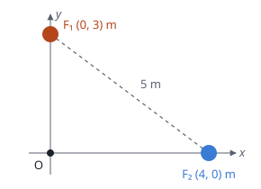

## Enunciado

Dos focos sonoros puntuales $F_1$ y $F_2$ están situados en las posiciones $(0, 3)\ \mathrm{m}$ y $(4, 0)\ \mathrm{m}$ del plano $xy$. Cuando emiten por separado, el nivel de intensidad sonora debido al foco 1 a una distancia de 2 m de este es $\beta_1 = 55\ \mathrm{dB}$, mientras que el nivel de intensidad sonora debido al foco 2 es $\beta_2 = 65\ \mathrm{dB}$ a 2 m de este. Halle:

1. La intensidad y el nivel de intensidad sonora en el origen cuando ambos focos emiten simultáneamente.
2. La distancia al foco $F_1$ del punto situado sobre el segmento que une ambos focos en el que las intensidades generadas por ambos focos son iguales.

**Dato:** Intensidad umbral, $I_0 = 1\cdot 10^{-12}\ \mathrm{W\,m^{-2}}$.

## Datos

- A 2 m de cada foco: $\beta_1 = 55\ \mathrm{dB}$ y $\beta_2 = 65\ \mathrm{dB}$
- Distancias al origen: 3 m desde $F_1$ y 4 m desde $F_2$
- Distancia entre focos: $\sqrt{3^2 + 4^2} = 5\ \mathrm{m}$

## Planteamiento

Los decibelios no se pueden sumar ni trasladar de un punto a otro directamente. Hay que pasar a intensidades: primero la intensidad de cada foco a 2 m, después su valor en el origen usando que la intensidad de un foco puntual cae como $1/r^2$, luego se suman, y solo al final se vuelve a decibelios.

## Resolución

### a) Intensidad y nivel en el origen

**Intensidades a 2 m.** De $\beta = 10\log(I/I_0)$:

$$I_1(2) = I_0\cdot 10^{55/10} = 3{,}16\cdot 10^{-7}\ \mathrm{W\,m^{-2}}
\qquad
I_2(2) = I_0\cdot 10^{65/10} = 3{,}16\cdot 10^{-6}\ \mathrm{W\,m^{-2}}$$

**Intensidades en el origen.** Como $I\,r^2$ es constante para cada foco:

$$I_1(3) = I_1(2)\,\frac{2^2}{3^2} = 1{,}41\cdot 10^{-7}\ \mathrm{W\,m^{-2}}
\qquad
I_2(4) = I_2(2)\,\frac{2^2}{4^2} = 7{,}91\cdot 10^{-7}\ \mathrm{W\,m^{-2}}$$

**Intensidad total y nivel.**

$$I = 1{,}41\cdot 10^{-7} + 7{,}91\cdot 10^{-7} = 9{,}31\cdot 10^{-7}\ \mathrm{W\,m^{-2}}$$

$$\beta = 10\log\frac{9{,}31\cdot 10^{-7}}{1\cdot 10^{-12}} = 59{,}7\ \mathrm{dB}$$

La solución orientativa oficial escribe 59,62 dB, pero con su propia intensidad ($9{,}31\cdot 10^{-7}$) el logaritmo da 59,69: es una errata.

### b) Punto del segmento con intensidades iguales

Sea $x$ la distancia del punto a $F_1$; a $F_2$ habrá $5 - x$. Las potencias son proporcionales a las intensidades a 2 m, así que $P_2 = 10\,P_1$:

$$\frac{P_1}{4\pi x^2} = \frac{P_2}{4\pi (5 - x)^2}
\quad\Longrightarrow\quad
\frac{(5 - x)^2}{x^2} = 10$$

Entre los focos las dos distancias son positivas y se puede tomar la raíz:

$$\frac{5 - x}{x} = \sqrt{10}
\quad\Longrightarrow\quad
x = \frac{5}{1 + \sqrt{10}} = 1{,}20\ \mathrm{m}$$

El punto está mucho más cerca del foco débil, como era de esperar.

## Errores típicos

- Sumar 55 dB y 65 dB, o promediarlos.
- Usar 2 m como distancia de los focos al origen.
- Resolver la ecuación de segundo grado y quedarse con la raíz negativa ($-2{,}31\ \mathrm{m}$), que no está en el segmento.
- Tomar 10 dB de diferencia como «el doble» de intensidad: son diez veces.
