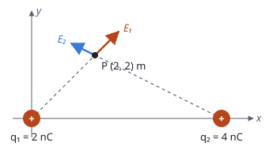

## Enunciado

Una partícula con carga 2 nC está situada en el origen de coordenadas mientras que una segunda partícula con carga 4 nC está situada en el punto $(6, 0)\ \mathrm{m}$ del plano $xy$.

1. Obtenga el campo eléctrico generado por ambas cargas en el punto $(2, 2)\ \mathrm{m}$.
2. Determine el punto situado entre ambas cargas en el que si situásemos un electrón la fuerza total sobre este sería nula. Obtenga el trabajo realizado por la fuerza electrostática para traer dicho electrón desde el infinito hasta el punto anterior.

**Datos:** Constante de la ley de Coulomb, $K = 9\cdot 10^{9}\ \mathrm{N\,m^2\,C^{-2}}$; Valor absoluto de la carga del electrón, $e = 1{,}6\cdot 10^{-19}\ \mathrm{C}$.

## Datos

- $q_1 = 2\cdot 10^{-9}\ \mathrm{C}$ en $(0, 0)$; $q_2 = 4\cdot 10^{-9}\ \mathrm{C}$ en $(6, 0)\ \mathrm{m}$
- Distancias al punto P$(2, 2)$: $d_1^2 = 2^2 + 2^2 = 8\ \mathrm{m^2}$ y $d_2^2 = 4^2 + 2^2 = 20\ \mathrm{m^2}$
- Electrón: $q = -1{,}6\cdot 10^{-19}\ \mathrm{C}$

## Planteamiento

Las dos cargas son positivas y sus campos se alejan de ellas. En P se suman como vectores. La fuerza sobre el electrón se anula donde se anula el campo, que será un punto del eje $x$ entre las cargas, más cerca de la menor. El trabajo del campo al traer una carga desde el infinito es $W = -q\,V$, con $V$ el potencial en el punto de llegada.

## Resolución

### a) Campo eléctrico en (2, 2) m

**Carga 1.** Módulo y dirección (de $q_1$ hacia P, a 45°):

$$E_1 = \frac{9\cdot 10^{9}\cdot 2\cdot 10^{-9}}{8} = 2{,}25\ \mathrm{N\,C^{-1}}
\qquad
\vec E_1 = 2{,}25\left(\frac{\vec i + \vec j}{\sqrt 2}\right) = (1{,}591\,\vec i + 1{,}591\,\vec j)\ \mathrm{N\,C^{-1}}$$

**Carga 2.** De $q_2$ hacia P hay que ir 4 m a la izquierda y 2 m hacia arriba:

$$E_2 = \frac{9\cdot 10^{9}\cdot 4\cdot 10^{-9}}{20} = 1{,}80\ \mathrm{N\,C^{-1}}$$

$$\vec E_2 = 1{,}80\left(\frac{-4\,\vec i + 2\,\vec j}{\sqrt{20}}\right) = (-1{,}610\,\vec i + 0{,}805\,\vec j)\ \mathrm{N\,C^{-1}}$$

**Total.**

$$\vec E = (-0{,}019\,\vec i + 2{,}40\,\vec j)\ \mathrm{N\,C^{-1}}$$

Las componentes horizontales casi se cancelan. Para obtener bien ese resto hay que llevar cuatro cifras en los sumandos.

### b) Punto de fuerza nula y trabajo

**Punto.** A una distancia $x$ de $q_1$ sobre el eje, los campos son opuestos y se igualan sus módulos:

$$\frac{K\,q_1}{x^2} = \frac{K\,q_2}{(6 - x)^2}
\quad\Longrightarrow\quad
\frac{6 - x}{x} = \sqrt{\frac{q_2}{q_1}} = \sqrt 2
\quad\Longrightarrow\quad
x = \frac{6}{1 + \sqrt 2} = 2{,}49\ \mathrm{m}$$

El punto es $(2{,}49;\ 0)\ \mathrm{m}$. No depende de que la carga colocada sea un electrón.

**Potencial en ese punto.**

$$V = K\left(\frac{q_1}{x} + \frac{q_2}{6 - x}\right) = 9\cdot 10^{9}\left(\frac{2\cdot 10^{-9}}{2{,}49} + \frac{4\cdot 10^{-9}}{3{,}51}\right) = 17{,}5\ \mathrm{V}$$

**Trabajo del campo** desde el infinito ($V_\infty = 0$):

$$W = q\,(V_\infty - V) = -1{,}6\cdot 10^{-19}\cdot (0 - 17{,}5) = 2{,}80\cdot 10^{-18}\ \mathrm{J}$$

Positivo: las cargas positivas atraen al electrón y el campo lo trae sin ayuda.

## Errores típicos

- Dibujar algún campo hacia la carga: las dos son positivas.
- Dar la componente $x$ como cero por redondear demasiado pronto.
- Olvidar el signo del electrón en el trabajo.
- Buscar el punto de equilibrio fuera del segmento.
